<p align="center">
  <picture>
    <source media="(prefers-color-scheme: dark)" srcset="site/brand/lyst-logo-on-dark.svg">
    
  </picture>
</p>

<p align="center">
  <b>An AI analyst that does the work, checks its own numbers, and shows you the evidence.</b><br>
  Self-hosted · Python 3.12+ · DuckDB · Streamlit · FastAPI · AGPL-3.0-only
</p>

<p align="center">
  <a href="https://github.com/MoRohn/lyst/actions/workflows/ci.yml"></a>
  <a href="https://morohn.github.io/lyst/">Website</a> ·
  <a href="docs/CAPABILITY_MATRIX.md">What works today</a> ·
  <a href="docs/ARCHITECTURE.md">Architecture</a> ·
  <a href="docs/SECURITY.md">Security</a>
</p>

---

You describe a question or a piece of work. Lyst plans it, runs it on approved data definitions with SQL and
Python, verifies the result independently, and returns a decision-ready answer with every query, check and
assumption behind it. It is judged by completed, verifiable work, not by conversation: every number comes from
a query, whether or not a model is involved.

<p align="center">
  <picture>
    <source media="(prefers-color-scheme: dark)" srcset="docs/images/analyst-dark.png">
    
  </picture>
</p>

**Why Lyst**

- **Verified, not plausible.** Every figure is recomputed independently from approved data, and each answer shows
  the checks it passed, the data and version it used, and the assumptions it made.
- **Does the work, asks before it changes anything.** Lyst plans, investigates, prepares recurring work and reacts
  to events on its own, inside limits you set; anything consequential waits for a person.
- **Yours to run.** Self-hosted, encrypted at rest, works with OpenRouter or a local model (or none), open source
  under AGPL-3.0.

**Contents:** [Quick start](#quick-start) · [Tour](#a-tour-of-the-interface) · [What Lyst does](#what-lyst-does) · [AI SDK](#build-on-lyst-with-the-ai-sdk) ·
[Models](#models) · [Security](#security-and-secrets) · [Commands](#commands) · [Development](#development) ·
[Documents](#documents)

## Quick start

You need [uv](https://docs.astral.sh/uv/) on macOS or Linux.

```bash
git clone https://github.com/MoRohn/lyst.git && cd lyst
uv sync --all-extras
uv run lyst start --demo
```

One command initialises encryption (the master key goes into the OS credential store), seeds the Northwind demo
workspace, starts the engine and the interface, and opens **http://lyst.localhost:8501**:

```text
Lyst is running at http://lyst.localhost:8501
  Engine     http://127.0.0.1:8770
  Interface  http://lyst.localhost:8501
  Data       ./var
  Demo       the Northwind workspace is ready; try "Why did operating margin decline last quarter?"
Ctrl-C stops it. From another terminal: `lyst status`, `lyst stop`.
```

`uv sync` installs Lyst into the project's `.venv`, so run commands through `uv run` from the checkout (a bare
`lyst` is "command not found" unless you first `source .venv/bin/activate`). From any terminal in the checkout:

```bash
uv run lyst status          # is Lyst running here, at which address, under which PIDs (--json for scripts)
uv run lyst stop            # stop the Lyst that `lyst start` launched; never touches processes it didn't record
uv run lyst start --check   # preflight: Python, data folder, encryption key, database lock and ports, opening no database
```

`lyst start` is safe to run again. If Lyst is already running here it opens that one instead of starting a second; if
a default port is busy it moves to the next free one and says so (an explicit `LYST_PORT` or `LYST_UI_PORT` that is
busy is a clear error); and if another program holds the data open it names that program's PID instead of failing
with a traceback. Ctrl-C in the starting terminal stops everything cleanly.

Then ask: **"Why did operating margin decline last quarter?"** Lyst finds that operating margin fell from 36.0%
in Q2 2026 to 32.5% in Q3 2026, that EMEA's own margin drop (36.8% to 24.0%) explains it, reconciles the
bridge exactly, and saves the analysis so it can be rerun for any period. That story is planted in the demo data
(`src/lyst/demo.py`) so the tests can check that Lyst recovers it.

No model is needed to try it. With none configured, Lyst runs on rules and templates; adding one improves
understanding and wording, never the numbers.

## A tour of the interface

One navigation with four areas (Home, Data, Brain and Settings), and one visual language behind every screen: a
calm canvas with raised, softly lit surfaces, a slim icon rail, dialogs that rise as sheets, native-style
segmented controls and buttons, the system typeface, and motion that respects reduced-motion settings, in light
and dark. A single set of design tokens drives Streamlit's widgets, Lyst's own components and every chart, every
screen is checked by an automated render with WCAG 2.2 AA accessibility scanning, and text and status colours meet
4.5:1 contrast in both themes. Data, Brain and Settings have tablet layouts as well as desktop and phone; ids and
codes read in plain words (in the audit trail, dataset relationships, the Brain map, Memory and saved analyses); and
an error reads as a sentence, never "Internal Server Error". Home is one composer that fills the page: Lyst's own mark sits
above it as its presence, still while idle, catching light while it works, rippling while it listens and glowing
amber when something waits on you. Below it are at most three starters drawn from your approved metrics, at most
one line for the single thing that most wants you, and a floating dock for what is in flight, what needs you,
**Get started** and **Recent** (pinned items and recent answers). Everywhere else, the **Lyst agent bar** sits at
the top of the page: ask by typing or speaking (asked from Data, Brain or Settings, the answer follows in a panel
without leaving the page), go anywhere by name ("go to SQL", "open definitions"; **Go to** opens ready to type and matches partial names), and watch Lyst work: a
**Watch** chip for what is running, a **Live** panel with each step and the event feed, and an opt-in **Follow
Lyst**; a running answer shows Lyst's mark and the current step over a hairline of progress. Data, Brain and
Settings each have the same **activity board** in the same place: under the page header when something needs you
or work is running, and otherwise one quiet line at the end of the page so the page's own content leads. It has
Suggested, Needs you, In progress and Done, scoped to the page with an **Everywhere** switch: click a card to open
it, hold it (or press M) for its actions, or drag it to another column to propose that move, with each column
saying what a drop would do; the keyboard works too (arrows, and Space to pick up and drop), every change asks for
confirmation and goes through the usual approvals and permissions, and viewers can only open cards. On desktop
the navigation is a 72px icon rail: Lyst's mark, then Home, Data, Brain and Settings, and at its foot, on the same
centre line: search (Ctrl/⌘+K opens the palette from anywhere), notifications (a count badge, unread dots, Mark all
read), help (the keys Lyst answers to, the glossary and the version) and your account (an avatar with your
initials, your role and workspace, the workspace switcher, Settings and Sign out). Every icon shows its label on
hover and keyboard focus, and each menu opens beside the rail; on a phone the menu opens as a sheet with words.

| Area | What you do there |
|---|---|
| **Home** | One question, "What should Lyst work on?", and a composer that grows as you write (Shift+Enter for a new line; on focus it offers **Add data** and keyboard hints). Ask, and the answer leads: the verified finding, why it matters, the trust line, one chart and what to do, with everything else one click away. Before you ask, Home shows up to three starters and at most one focus line (a question that needs your input, an answer that did not verify, a blocked run, or "add data" on an empty workspace), never a list. The dock at the foot holds work in progress, what needs you, **Get started** (a progress ring and the one next step, in a sheet) and **Recent** |
| **Data** | Opens as a flow: where the data comes from (**From**), the datasets, and the approved metrics they **Feed**, joined by lines (solid from source to dataset, dashed from dataset to metric). Each dataset's face is its *shape*, one bar per column coloured by what the column holds. Hover, focus or pick anything and its whole path lights up, upstream and downstream, so "what depends on this?" is answered by looking. Click anything and it opens as a sheet over the page, laid out for what it is. A dataset shows its shape, one sentence on it, its state (Ready to use, or **Review: 1 to fix** first), rows, columns, how recent it is and what it feeds, with **Analyze**, **Ask about it** and **More**, and Preview, Columns, Quality, Relationships, SQL and Contract inside the sheet. A source lists the datasets it gives (or, for a connection, its health, **Test** and **Sync a table**), and a metric shows its latest value, trend, how it is calculated, the dataset it reads and **Open in Brain**. Sheets lead to each other (source, dataset, metric), and closing one puts the flow back as it was. Above the flow sit Lyst's one line on the data (a link straight to the quality checks when a dataset needs a look), **Find a dataset**, **Add data** and **More** (Sources, Dashboards, Saved analyses, SQL (a misspelled column is named in the error) with a sandboxed **Python** tab, and How the data connects). The keyboard works throughout |
| **Brain** | Opens on a map of what Lyst knows: metrics, datasets, terms, memories and answers, gathered by kind, with pills to filter and a search that highlights matches as you type ("rev" finds Revenue). Downloads appear on the map under the question they answered. Pick a thing and only its relationships are drawn (with a filter open, what it connects to in other kinds comes in dimmed at the edge, and picking one opens its kind); a panel says what it is (a metric shows its value and trend), what it connects to (each a step further), and offers **Ask about it** and **Open**. With nothing picked, the panel shows what Lyst learned and used lately. **Work** holds needs you, activity (Running, Done, Stopped, Automatic, Decisions, Published) and recurring work. **More** holds Definitions, Documents, Memory (with memories waiting for review), Graph (with graph runs and the harness) and Specializations, the catalog of 136 kinds of analyst work |
| **Settings** | Seven sections in one native-style list: **Account** (who you are, your workspaces, personal keys, sign out), **Workspaces** (members, business profile, usage and limits, move or copy), **Connections** (credentials, notifications and webhooks), **Models & Voice**, **Privacy & Security** (the external-model switch, data policy and audit trail), **Preferences** (autonomy, working ahead, event rules, the Get started guide) and **Advanced** (skills, capabilities, evaluation runs, health, backups). Lyst checks the setup itself (no model connected, data not encrypted at rest, a failing health check) and opens the section that fixes it, or says in one quiet line that nothing needs a look. Settings stays short: details sit behind help icons, the model line reads like "X, then 2 fallbacks if a call fails", and the audit trail reads in words ("A memory saved · Avery Lin · 2 min ago"). Technical controls such as the full model list and prices, installation policy, who reads what and the full audit trail open as sheets |

<p align="center">
<picture>
  <source media="(prefers-color-scheme: dark)" srcset="docs/images/home-dark.png">
  
</picture>
</p>

<p align="center">
<picture>
  <source media="(prefers-color-scheme: dark)" srcset="docs/images/get-started-dark.png">
  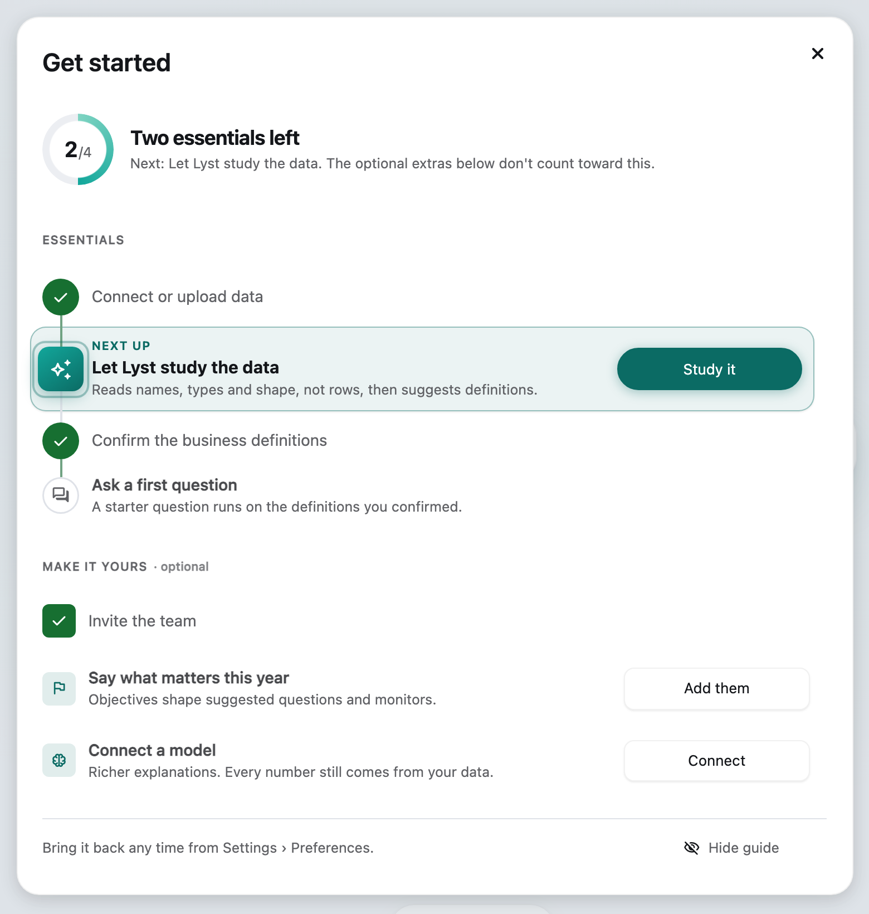
</picture>
</p>

<p align="center">
<picture>
  <source media="(prefers-color-scheme: dark)" srcset="docs/images/settings-dark.png">
  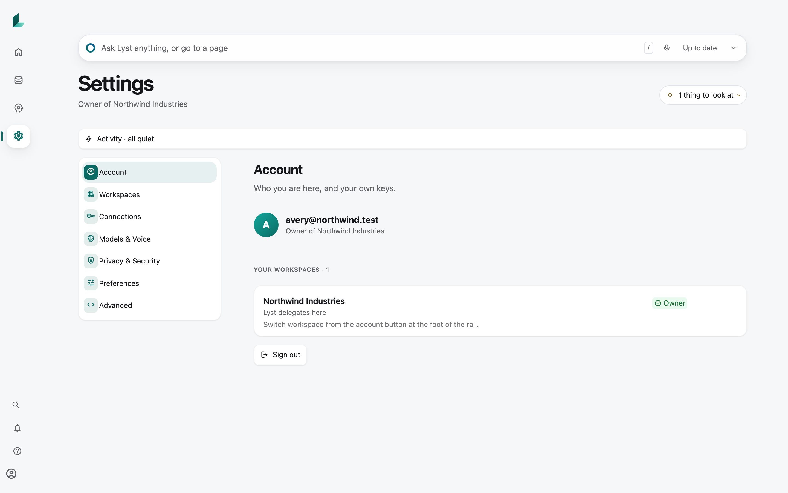
</picture>
</p>

<p align="center">
  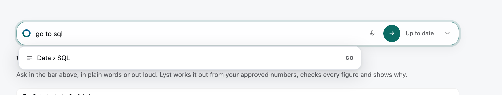
</p>

### ⌘K: ask or go anywhere

Press Ctrl/⌘+K anywhere to ask a question, jump to any section, reopen a recent question, find a dataset or
metric, see which analyst specializations match (with their honest maturity level), or switch workspace.
Breakdown answers show their split as a chart.

<p align="center">
  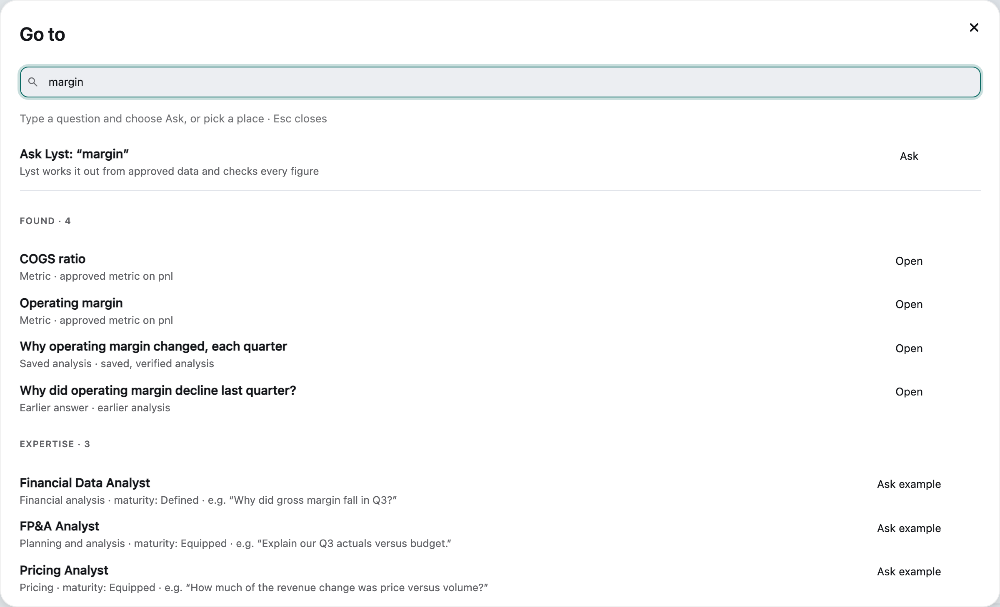
</p>

### What Lyst makes is an artifact

Dashboards, charts, briefings, slides, workbooks and saved analyses appear as previews drawn from their own
content, and open in an immersive viewer made for each kind: an interactive dashboard with a period range, slides
as slides, a workbook sheet by sheet, a PDF page by page. A downloaded PDF, deck or workbook opens on a **Preview** of
its answer with live charts in the current theme, with the file's own pages, slides or sheets in the next tab
(workbook sheets show real column names, percents and months) and **Download** as the main button at the top. Inspect the evidence behind any of them, ask Lyst to
refine it in words ("break that down by region", "compare it to last year", "every Monday", however you phrase or
quote it), see its versions, pin it to Home's **Recent**, and return exactly where you were. Every chart in an answer
appears under **Made in this answer**, Data › More › Dashboards is the gallery of everything made, and ⌘K finds artifacts
by title.

Data and Brain have deeper views a step away. Data › More › **How the data connects** is a map of how datasets connect
through the columns they share; Brain › More › Definitions shows each definition as what it means and how it is built, or a **Map**
from data to approved metrics.

<table>
  <tr>
    <td width="50%">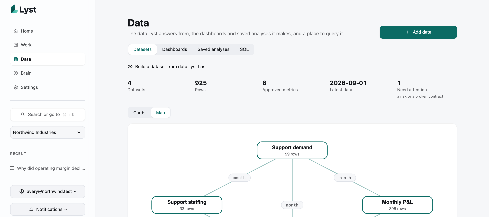<br><b>Data map</b>: datasets linked by the columns they share</td>
    <td width="50%">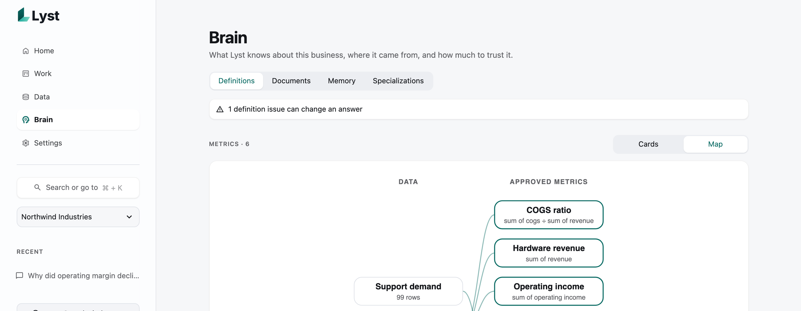<br><b>Brain map</b>: from data to approved metrics</td>
  </tr>
</table>

### Brain › More › Graph, and graph runs

Brain › More › **Graph** shows every dataset, approved metric, business term, document, memory, business
entity, analysis and artifact, plus graph runs and the rules they learned. A link is a relation Lyst recorded or a
literal mention, never an inferred one. Search, zoom, pan, drag, hide a kind from the legend, or use **List** from
the keyboard; clicking a node shows its backlinks and opens it where it lives.

**Runs** takes a goal written one job per line and runs it as a graph: a Planner splits the jobs into branches (they run
at the same time unless one names another's answer), a Builder does each branch as an ordinary Lyst analysis, a
Checker grades the stored result against requirements a program can fail, a Gate routes it to pass, repair, escalate
or stop, and a code Merge orders the answers. Only a failing branch goes back for repair, with the reason and evidence;
three failed repairs escalate to a person. Work is laned by blast radius: reading and analysing passes on its checks,
defining or sharing needs a clean record or a person, and anything that deletes, sends, pays, deploys or was named as
needing approval never starts without a person's approval. Repeated failures become rules the Planner reads next time,
and **Harness** shows them. Each run leaves its state, a check table and the graph as it ran.

Limits, stated plainly: builders are Lyst analyses, so a graph run cannot do anything a person's own question could
not, and it does not write code, deploy or move money; the Planner splits the text you write rather than decomposing a
goal with a model; the "independent path" check re-runs the recorded queries rather than deriving the answer a second
way; and the morning brief and weekly review are produced on request, not yet on a schedule
([docs/GRAPH_RUNS.md](docs/GRAPH_RUNS.md)).

<table>
  <tr>
    <td width="50%">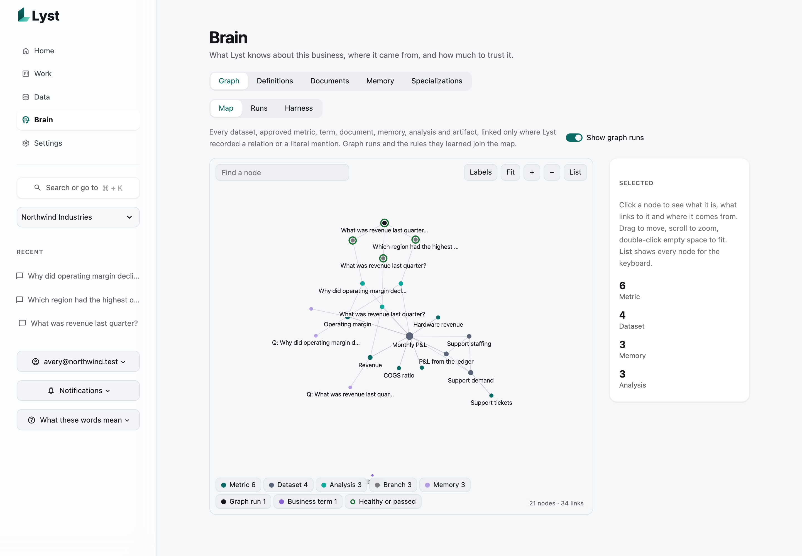<br><b>Brain › More › Graph</b>: what Lyst knows, and how it links</td>
    <td width="50%">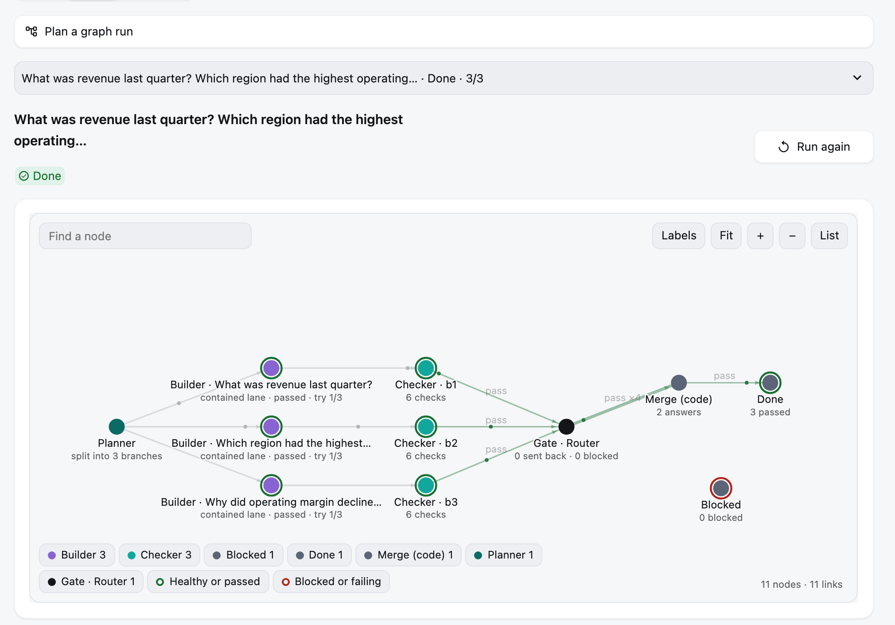<br><b>A graph run</b>: three branches built, checked and merged</td>
  </tr>
</table>

### Talk to it like a colleague

Not every question needs a number. Ask what exists, how to do something, what a metric means, or just say hello,
and Lyst replies in conversation from what the workspace actually holds (dashboards, reports, datasets, approved
metrics, rules, watches, repeatable analyses), read with your permissions. A reply computes nothing, so it is never
marked Verified and carries no number a model made up; it says so in one line. When it can help, it makes an offer
("Want me to?"), and **yes**, "go ahead", "the second one" or "2" runs that offer through the same pipeline, roles
and approvals as if you had typed it. Replies follow the last few questions and answers, and a figure repeated from
them must come from those checked answers. A question about figures that names no approved metric is no longer
answered with the nearest one: Lyst says which metrics exist and how to add one.

<p align="center">
  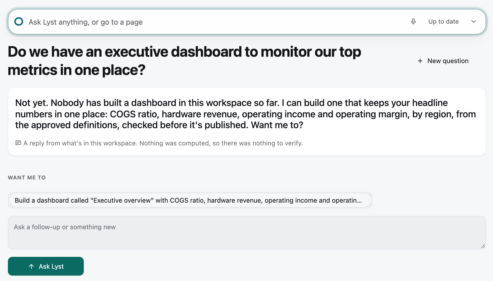
</p>

### Every answer: the finding first, the details one click away

An answer opens on what matters: the **Verified** badge, the finding, one line on why it matters, the trust line
("All 10 checks passed: every figure was recomputed independently from approved data"), any caveats, one chart and
**What to do**. **Why, and the details** opens the evidence, tables, the explanations tested, the assumptions, the
expertise applied and what the answer made. **Method, checks and queries** opens every source, check, the plan and
every governed query with its SQL. Caveats stay visible at every layer. **Brief** gives the two-line version with
one chart and the PDF briefing, ready to forward.

Under the answer sit four menus. **Keep watch** watches the metric or repeats the question. **Download** gives a PDF
briefing, a deck, an Excel workbook or Markdown, each carrying everything the answer shows, charts included (native,
editable charts in Excel and slides, vector charts in the PDF, an embedded chart with its data in Markdown; in the PDF and Markdown every chart appears once, at full size).
**Share** assigns it, asks for a review or publishes it. **More** holds Discuss, What if, Compare options, How this
ran (each step, query and model call with its timing and tokens) and what Lyst can do with this answer right now:
break it down, compare it, explain it, make a dashboard, or repeat it (marked as needing approval). Below them is one
**Next** block: the suggestion Lyst ranks first as a card (its reason in one line, one main button such as Run now
or Watch it, and Why, Later and Dismiss in a small menu), then one row of choices mixing Lyst's other suggestions
with follow-up questions, never repeating what the answer already shows. **How was this figured?** opens *About
this answer* from the engine's own records, drawn for people rather than as SQL: the approved definition in words
(**Operating margin = Operating income ÷ revenue**, with its version), a tile per figure with its steps in plain
words and its query count, the queries folded away, a card for each dataset it read (title, version, rows, when it
loaded, sensitivity), whether the data has changed since, and whether running it again returns the same rows.

**Is this right?** Mark the answer **Right**, **Partly** or **Wrong**, add what it should have said if you like, and
**Undo** any time. A wrong answer stops being reused, recalled or cited; a right one becomes validated memory.

**When Lyst needs you, it asks one plain question with choices.** An answer that needs your input or did not verify
says so in words ("“Margin” matches more than one approved metric: COGS ratio or operating margin") and
asks, for example, *Which "gross margin" do you mean?*, offering the approved metrics it could be (each with its
definition), a way to map the word for everyone (admins confirm it in place; editors ask an admin, and nothing changes
until another admin approves), *Not needed any more* and **Something else** for your own words. Lyst carries out the
pick: it asks again with the metric you chose, offers the closest metrics for one it does not know, or opens the data
quality review when checks failed. The choices come from the workspace (approved metrics, the glossary, datasets,
failed checks), never from a model's guess; every pick is checked again by the engine, the original answer is never
rewritten, and each resolution is recorded and audited. The same choices are on each item in Brain › Work › Needs
you (**Resolve**).

<p align="center">
  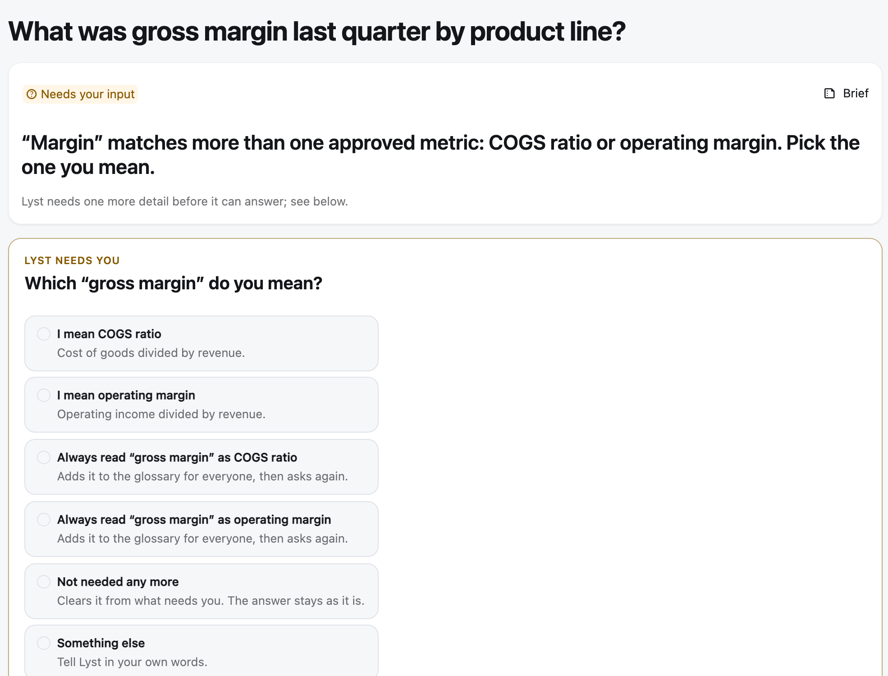
</p>

<p align="center">
  
</p>

<table>
  <tr>
    <td width="50%"><picture>
  <source media="(prefers-color-scheme: dark)" srcset="docs/images/brain-dark.png">
  
</picture><br><b>Brain</b>: a map of what Lyst knows</td>
    <td width="50%"><picture>
  <source media="(prefers-color-scheme: dark)" srcset="docs/images/data-dark.png">
  
</picture><br><b>Data</b>: from where data comes from, to the metrics it feeds</td>
  </tr>
  <tr>
    <td>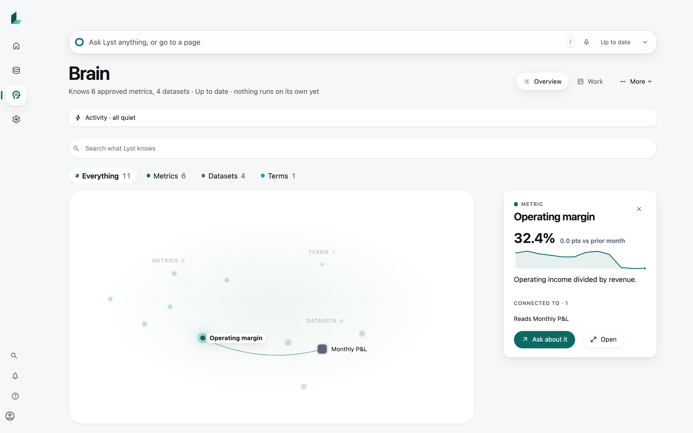<br><b>Pick a thing</b>: only its relationships are drawn</td>
    <td>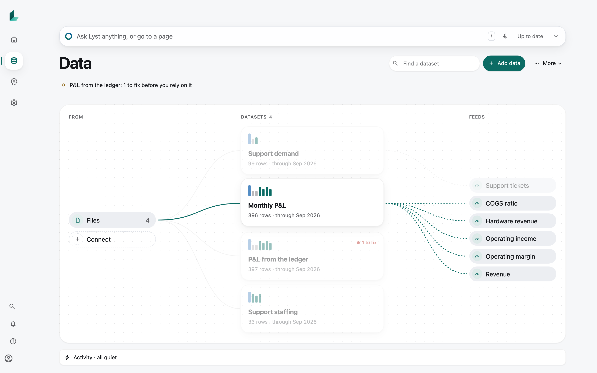<br><b>Hover a dataset</b>: its whole path lights up</td>
  </tr>
  <tr>
    <td colspan="2" align="center"><br><b>Brain › Work</b>: needs you, activity and recurring runs</td>
  </tr>
</table>

### What if?

Ask a what-if in plain words on Home, such as "What happens to operating margin if labor costs increase 6% while
revenue grows 3%?". Lyst answers from a driver model whose observed inputs are read from governed data for a named
period (the same "last quarter" as every other answer, named in the headline: "from 32.49% (Q3 2026 actual)"),
with your own permissions, and whose assumptions carry a plausible range. The answer is labelled
hypothetical, lists the observed inputs (period, dataset version, data-through date), the assumptions and the
formulas as evidence, and is recomputed independently. Changes can be given as percentages or in points ("COGS
ratio rises 2 points"). A driver the model does not have is listed as "Not modelled", never guessed, a change to something
the model cannot move says what it can change instead, past tense works too ("What if costs fell 10%?"), any change
Lyst could not apply is stated, and such an answer is never marked Verified. From there: tornado sensitivity, best, base and worst cases, a seeded Monte Carlo (P5,
P50, P95 and the chance of falling below a threshold), and saved scenarios that can be rerun and compared, with
any drift reported.

On an answer whose metric has a driver model, **What if…? Explore** opens sliders for each driver, shows base →
scenario marked Better or Worse, where the starting figures come from, **How sensitive is it?** and **Save this
scenario**. Saved scenarios live in Data › More › Saved analyses › Scenarios with Explore, Open and Re-run.

Decisions get the same care. Lyst tells an analytical question apart from a decision that needs authority,
compares options on weighted criteria and constraints under uncertainty, finds where the leading option would
change, and allocates budgets with an exact solver. It says "insufficient evidence" or "no clear winner" rather
than claim one. A **decision record** goes from analyzed to submitted to approved or rejected by a person, who
may pick a different option, and is later reviewed against what actually happened. Nothing is executed. Editors
start one with **Compare options** on an answer, and records are listed in Brain › Work › Activity › Decisions.

<table>
  <tr>
    <td width="45%"><br><b>A what-if answer</b>: hypothetical, with its inputs</td>
    <td width="55%"><br><b>What if…?</b>: move the drivers, see what moves it most</td>
  </tr>
</table>

### Dashboards from a sentence

Data › More › Dashboards › **New dashboard** turns a request into a Plotly Dash app on Lyst's own kit
(`src/lyst/dashkit`, vendored into each app so it runs anywhere with PyPI packages only): governed metrics,
verified SQL, KPI cards, a trend with a forecast band, click-to-filter breakdowns, and a Data and method page.
Every generated app is checked in a separate interpreter before it is offered.


### A look before loading

**Add data › Upload a file** reads spreadsheets, CSV and other tables, and documents, then shows what it found
before anything loads: each table with its rows, sheet and range, whether a total row adds up, notes and a
preview. Keep or drop each table, name it, then **Load it** or **Discard**.

<p align="center">
  
</p>

### Lyst knows your data

Every dataset version is profiled on arrival. Lyst learns its grain, keys and column meaning, finds duplicates at
the grain, outliers, concentrated missing values, time-series gaps and stale data, and ranks what to check
before relying on it. Each dataset in Data carries a chip (**Trusted**, **N to fix**, **Contract broken**), and
its Overview shows those risks, what depends on it, and how it connects to other data: key candidates, shared
dimensions, and overlapping sources reconciled by their totals.

* **Data contracts.** Lyst drafts a contract from the data (columns, types, allowed values, what identifies a
  row). Once adopted, it is versioned and checked on every refresh. A breaking change upstream is flagged with
  the metrics, dashboards and saved analyses it affects, and reaches the owners' inbox once.
* **Metric lineage.** Each definition shows where its number comes from (source, freshness, contract), its
  versions with field-level changes, and what uses it. Retiring a definition can name a replacement that
  requests and terms then follow. A definitions health line in Brain lists duplicates, conflicting sources,
  ambiguous synonyms and stale definitions, each with its fix.
* **Search** across datasets, columns, metrics, terms, saved analyses, dashboards, documents and earlier
  answers, filtered by what you may see. Each result opens where it lives.

<table>
  <tr>
    <td width="50%"><br><b>Before you rely on it</b>: ranked risks found in the data</td>
    <td width="50%"><br><b>Contract</b>: drafted from the data, adopted in one click</td>
  </tr>
  <tr>
    <td colspan="2" align="center"><br><b>Definition</b>: where the number comes from, versions and retirement</td>
  </tr>
  <tr>
    <td colspan="2" align="center">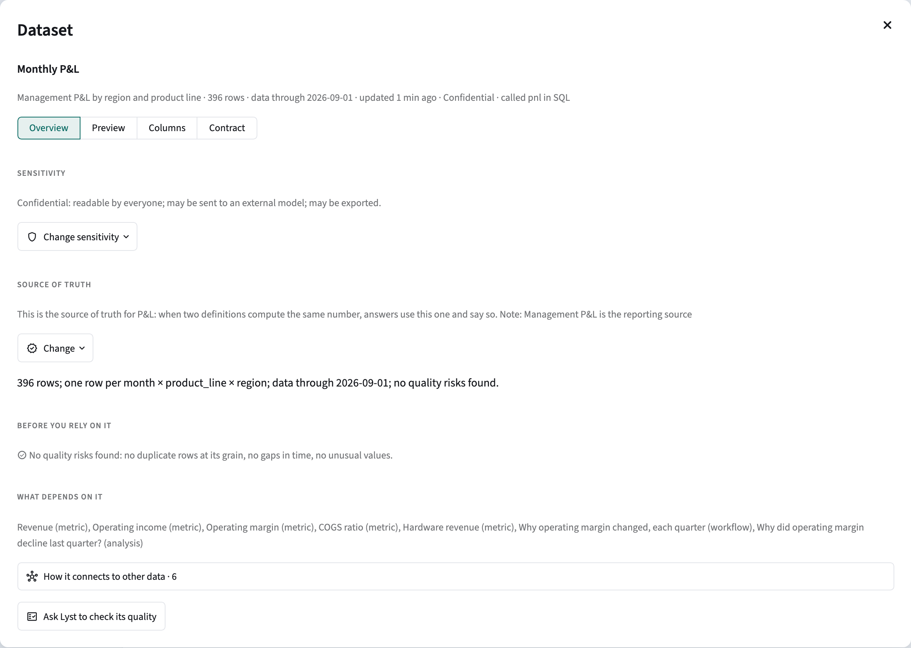<br><b>Sensitivity and source of truth</b>: on every dataset</td>
  </tr>
</table>

### Review data quality with Lyst

Every flagged row in a dataset (a duplicate, an empty cell, a stray negative, an unusual value) is a row in one
review table: the dataset's own columns with the flagged cell lit, the issue and why, and what Lyst suggests with
its confidence. Mark each **Valid** (a real edge case, nothing changes), **Fix** it inline or **Exclude** it, one at a
time or in bulk. **Let Lyst resolve** stages a fix for each open issue it can, with its reason, from the data itself:
drop a duplicate (naming the row it copies), reconcile a cell from an identity the data carries (when `revenue =
cogs + opex + operating_income` holds in 395 of 396 rows, the empty revenue is the value that makes it hold), or
estimate from neighbouring periods and say it is an estimate; otherwise it says a person is needed, and it never
overrides a person's call. Staged changes show as a diff with row counts and totals before and after. Applying them
needs an approval; once approved they become a new dataset version with the same schema, the earlier version is
kept, and **Undo** puts it back. If the data changed after staging, the resolution is refused as stale. Open it from
Lyst's one line on Data, a dataset's **Review** or **More › Review data quality**, or by simply asking ("Are there any
data quality issues in the pnl dataset?" runs the check; "Is our data clean?" with no dataset named checks every
dataset you can read and reports the open issues worst first, with the fixes it can propose, changing nothing until a
fix is approved); a profiling
answer shows the table in place.

<p align="center">
  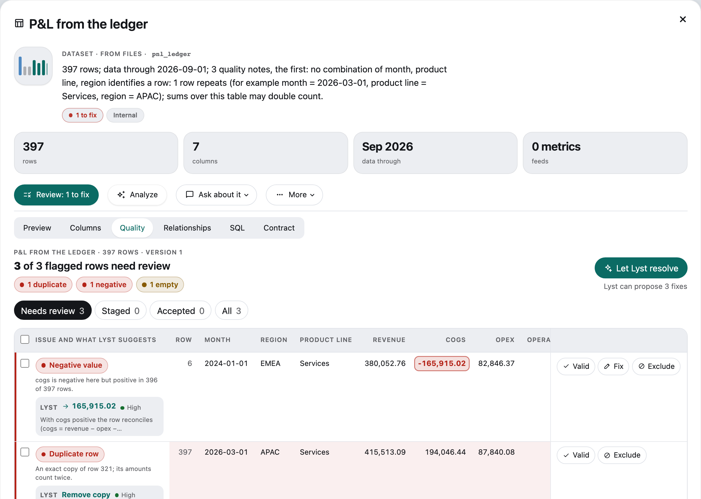
</p>

### Sources that tell you what is wrong

Data › More › **Sources** lists each connection with a health chip (**Healthy**, **Degraded**, **Failing**,
**Needs action**, **Not tested**). When something is wrong, the row says the one thing to do instead of the
usual details. A source's dialog shows the cause in plain words (sign-in, permissions, rate limit, time-out, the
source itself), the last 24 hours of operations, errors and retries, every table it feeds with its sync mode,
freshness, schedule and contract, and the credential's status (never the secret), with Test and Sync at hand.

<table>
  <tr>
    <td width="45%"><br><b>Sources</b>: one chip and one action per connection</td>
    <td width="55%"><br><b>A degraded source</b>: the action, the cause and what it feeds</td>
  </tr>
</table>

### What Lyst makes stays current

Reports (PDF briefings, workbooks, decks), dashboards and saved analyses share one registry with an owner,
versions, validation status, and the question, dataset versions and metric versions each was built from. Every
new data load and definition change re-assesses them, and the owner hears once when one stops matching the data.

In Data › More › Dashboards and Saved analyses, a row gets a chip only when it needs attention: **Out of date** (newer
data), **Needs rebuilding** (a definition changed), **Broken** (an upstream contract break) or **Updating**.
**Reports from answers** lists every briefing, deck and workbook downloaded from an answer, with **Check all**.
Opening one says why in words and offers one button: **Refresh it** for a dashboard (the previous version is
kept) or **Rebuild it** for a report or saved analysis, which reruns the question on current data. Only a verified
result becomes a new version; a failed repair restores the earlier state with the reason, and a cause upstream
says a person is needed.

<table>
  <tr>
    <td width="45%"><br><b>Reports from answers</b>: health at a glance</td>
    <td width="55%"><br><b>Needs rebuilding</b>: the reason and one-click repair</td>
  </tr>
</table>

### Working as a team

* **Discuss anything.** Comments, replies and `@mentions` on an investigation, analysis, report, metric or
  dataset; **change requests** that stay open until resolved; and **decisions** recorded and listed across the
  workspace. A private report's thread is exactly as private as the report.
* **Assign work** with a note and a due date; the assigner hears when it is done.
* **Reviews before shared changes.** An editor can propose a metric definition, a data contract or publishing a
  private report; nothing applies until an admin other than the proposer approves it, and the review is kept in
  the metric's history and the audit log.
* **Sharing and ownership.** Reports are private, shared with named people, or visible to the workspace, and
  ownership of reports, datasets and metrics can be handed over.
* **Your notifications, your way.** Mentions, assignments, reviews, decisions and comments on what you own
  arrive in one list with platform notices, and each kind can be switched off per person.

On screen: **Share** and **Discuss** sit on every answer; **Brain › Work › Needs you** adds *Assigned to you* (Open, Done)
and *Reviews waiting* (Open, Approve, Reject), counted on the rail; and **Notifications** on the rail open
where they point, with Mark all read and "What to tell me about".

<table>
  <tr>
    <td width="45%"><br><b>Discuss</b>: comments, change requests and decisions</td>
    <td width="55%"><br><b>Notifications</b>: open where they point</td>
  </tr>
</table>

## What Lyst does

### Analysis you can rely on

* **Answers and investigations.** Values with prior-period and year-ago comparisons (a single figure comes with
  its recent history as a chart, and "by region year over year" compares each member with a chart of the changes
  and a table of both periods; year to date is compared with the same months a year earlier), breakdowns, rankings ("top 3 regions by operating income", "which clients bring in the most income?", "our biggest expense
  categories", "which channel had the
  fewest tickets"), trends over the window you ask for (one named
  line per member for "revenue trend by region"), with a headline that says where the metric went and its
  biggest move, the peak period named ("which month had the highest revenue in 2025?"), anomalies, forecasts with
  backtests ("next N quarters" forecasts each quarter, a partly loaded month is left out, and a quarter's forecast is read against the last complete quarter), "why" questions with exact rate and mix attribution, leading on screen and in every download with each segment's share
  of the move (a rise is called a rise, members named in words
  such as "product line Hardware", and a question about one segment, such as "Why did COGS ratio change in EMEA?",
  investigated and verified within that segment), deep investigations
  that decide between competing hypotheses by computation, staffing scenarios under uncertainty, and event
  impact with stated assumptions.
* **Everyday questions, answered the way they were asked.** Name two quarters ("Compare revenue by region for Q2 and
  Q3 2026") and Lyst shows each region's change between them. Ask what drove growth "year over year" and the change
  is explained against the same quarter a year earlier. "Which region grew fastest?" ranks by revenue growth when no
  metric is named, and says so. "Is the drop significant?" is judged against how much the metric usually moves, and
  Lyst says plainly that this is not a formal statistical test. "How many staff do we need next quarter?" answers
  with a headcount, from the demand forecast and the staffing data. "What should we do about EMEA?" investigates the figure
  that moved most the wrong way there and turns it into recommended actions; if nothing went wrong, it says so.
  "How accurate were your last forecasts?" checks every forecast Lyst gave against the months that have since
  arrived: how far off it was on average, how often the actual landed inside the forecast's range, whether it ran
  high or low, the biggest miss, and each metric's real error against the error its backtest claimed. A forecast
  that cannot be checked yet says which month it is waiting for. Simple figures stay simple; investigations and
  forecasts keep their checklist note.
* **Business briefs.** Ask for a brief ("Give me a weekly KPI brief", "What changed this month?", "Board
  briefing on Q3 2026", "Brief me on revenue"). Lyst reads every approved metric you can query for the last complete
  month or quarter (or the one you name), flags what moved more than that metric usually does, against last period
  or a year ago (so a step change that then holds flat is still caught), names runs in one direction and the segment
  behind each big move, and lists open alerts, approvals waiting and how current the data is. It stays short: the one move with a clear
  place to act is told in full, and the others are named. Metrics with no data
  for the period are named, not dropped. Every figure comes from a recorded query and no model writes the wording.
  "Send me the KPI brief every Monday" answers now and sets up the weekly schedule, which starts once an admin
  approves it.
* **Small business and freelancers.** Bring your invoicing and expense exports and Lyst proposes starting
  metrics (income invoiced, expenses, invoices sent, active clients). Ask "Who owes me money?" for what each client
  owes today, how late it is, how long clients take to pay, and who to remind first. Lyst never contacts a client
  itself. "What was my profit last quarter?", "How much did I make this year?" or "Am I making money?"
  works across separate income and expense exports: income minus expenses and the margin for the last complete
  month, a named month or quarter, or the year so far, against the period before and a year earlier, with the last
  12 months, the best and weakest month and any month that lost money. It says plainly that this is a simple profit,
  not tax or accrual accounting, and it steps aside when the workspace has its own profit or margin metric.
* **Annotation QA.** Ask "How consistent are the annotators?" and Lyst measures agreement (Krippendorff's
  alpha), names the label pairs annotators confuse and the annotator who labels differently from the team, and lists
  the items to adjudicate, hardest first, with a chart of how often each annotator agrees with the rest; agreement
  shows as percents in every download. The data quality review also catches the same label spelled different ways
  and blank labels, and proposes the fix for approval. "Document the annotations dataset" writes a datasheet from
  what Lyst has measured (naming the owner), and "Write annotation guidelines" drafts a guideline from how the labels were used,
  leaving the definitions to your team. Lyst never relabels anything itself.
* **Incident and change review.** Load an incidents export and a change log and ask "What was our time to restore
  last quarter?", "What is our change failure rate?" or "Which changes caused incidents?". Lyst reports incidents by
  severity and service against the period before, median and mean time to restore, incidents still open, the change
  failure rate, and the changes behind incidents. A change counts as the cause only when the incident names it; a
  change on the same service shortly before is shown as a possible link.
* **Close checks.** "Run the month-end close checks", "Is August 2026 ready to close?" or "Does the P&L tie to
  the ledger for Q1 2026?" checks every dataset behind an approved metric for the last complete month or quarter (or
  the one named): the period has **arrived** complete (every segment that reported last period reported this one),
  it is **clean** (no exact duplicates, no missing amounts), it **ties out** key by key within 0.5% to any second
  source carrying the same measures, and the **flux** lines that need a comment are listed segment by segment against
  last period and a year earlier. Lyst reports only: it never posts a journal, edits data or marks a period closed,
  and a second source you cannot read is listed as not checked. "Every weekday at 9" repeats it, after approval.
* **Checks its own work.** Independent validation scaled to consequence (high-stakes answers are recomputed from
  raw rows in pandas), join fan-out and stale-source detection, ambiguous terms surfaced instead of guessed, and
  model wording verified against the computed numbers.
* **Shows its working on request.** Any figure in an answer or a generated report traces back through the step
  that computed it, the SQL that ran, the metric version and the dataset version (rows, checksum, load time,
  classification) to its source, with the checks, assumptions, citations and approvals involved. A figure counts as
  traced only when a stored result backs it at the precision written. Ask how it was figured, what it rests on,
  what would change it, or have Lyst reproduce it under your current permissions; the answers come from those
  records, not invented explanations, and Lyst says when the data behind an answer has a newer version.
* **One analyst, many specializations.** Lyst stays one analyst that assembles the expertise a request needs from
  136 specialization profiles in 11 domains (data and BI, statistics, AI and ML, software, cloud, security,
  finance and operations, marketing, media, science and industry, and more), backed by a shared library of method
  families and verification rules. Every task is routed, whether it starts on Home, the agent bar, the activity
  board, a schedule, a follow-up or a monitor, and the activity board shows which specialist took it. A router
  picks the disciplines with its reasons, never grants a permission a person lacks, and reports methods Lyst does
  not have yet. All 136 analyst specializations are Operational: each one's representative task runs end to end on
  controlled sample data and finds the right answer, re-checked by the test suite. That does not mean validated on
  real data, or that every request in a discipline will work; a workspace still needs its own data and metrics.
  When a question is routed to specialists, their discipline's checks apply and can only tighten verification; the
  answer reports each as passed, failed or not applicable, and says which cannot yet be run automatically. Lyst
  also checks that an answer addresses the question it was asked: a specialist request that a governed metric
  cannot answer is flagged instead of being answered with the nearest number. Brain › More › **Specializations** lists
  all 136 with the evidence behind each, and example questions can be asked in one click. An audit of every role's
  example requests is in [docs/SPECIALIZATIONS_AUDIT.md](docs/SPECIALIZATIONS_AUDIT.md)
  ([docs/SPECIALIZATIONS.md](docs/SPECIALIZATIONS.md)).
* **Tests its own methods on your data.** Experiments compare forecasting methods (naive, seasonal naive, mean,
  drift, linear trend and ETS) on an approved metric with rolling-origin backtests and standard error measures,
  name a winner only when the difference is statistically significant, and otherwise recommend the simplest
  method. Every run records its exact series, dataset and metric versions,
  SQL and environment, and can be reproduced to show what, if anything, changed. An admin records the chosen
  method, and a choice against the evidence is flagged.
* **Follows up and reuses what works.** A follow-up such as "now by region", "compare it to last year" or "what
  about Q1 2026" is resolved against the earlier answer's verified understanding, and the new answer records what
  changed and what was carried over, so re-asking reproduces it. A follow-up Lyst cannot carry out says so rather
  than changing numbers silently. Before drafting a new method, Lyst ranks the approved skills and built-in
  capabilities by what they do, checks each is still compatible and permitted, and reuses the best one. Through
  the API today.
* **Gets faster with use.** A verified analysis compiles into a typed, versioned saved analysis. Matching
  requests reuse it, and a changed data layout or metric definition marks it out of date until it is verified again.
* **Learns from your verdicts, and shows whether it is getting better.** Mark an answer **correct**, **incorrect**
  or **partly**, with an optional note or correction. An incorrect verdict stops that answer from being reused,
  recalled or cited: its memory leaves recall, the saved analysis it ran on is held back with the reason, and the
  next question is planned afresh. A correct verdict raises its memory to person-validated, and a correction is
  kept as validated team memory. Any verdict can be withdrawn, which undoes its effects. A saved analysis that
  keeps failing verification is held back too. One learning report counts, from stored records only, verdicts and
  the judged-correct rate, reuse, held-back analyses, harness rules that worked or did not, and what memory can
  recall. The CI gate now includes a learning category that proves reuse, dispute and withdrawal work, so breaking
  the loop fails the build. Verdicts are given under each answer (**Is this right?**) or through the API
  ([docs/LEARNING.md](docs/LEARNING.md)).
* **Speaks your fiscal calendar.** The fiscal year start in the business profile drives "last quarter", "FY2026",
  year to date and their comparisons, and quarterly and yearly charts, trends, dashboards, monitors and forecasts
  group by fiscal quarter and year, labelled like "Q4 FY2027". Calendar-year workspaces are unchanged.
* **A workbench for your own Python and SQL.** Analysts run their own Python on governed data in an
  operating-system sandbox, on data already filtered by their column and row permissions. The code cannot read
  Lyst's databases, keys or home folders and has no network access. Every run records its code, inputs, data
  versions and software environment, so it can be reproduced and compared, and a result table can be saved as a
  dataset with its lineage. On macOS the sandbox is verified by tests; on Linux it uses bubblewrap. It lives in
  Data › More › SQL › **Python** ([docs/EXTENSIBILITY.md](docs/EXTENSIBILITY.md)).
* **Voice.** Ask a question out loud and hear the verified answer read back, with the full result on screen. A
  spoken question goes through the same Analyst as a typed one, picks the same expertise and runs as you, through
  the same permissions, data policy and budgets as a typed one. Voice cannot approve, delete, send or export
  anything; those go to the screen to confirm, and saying "stop" stops Lyst talking without stopping the analysis.
  Audio is not kept unless an administrator turns that on, and transcripts are redacted. Speech uses the browser
  by default; OpenRouter speech-to-text and text-to-speech are available once an admin allows external audio, and
  an NVIDIA PersonaPlex server on your own GPU can add full-duplex conversation (Lyst never bundles its weights,
  and that path has not yet been verified on real hardware). On screen: **Speak** beside the ask box (push-to-talk
  or hands-free, using the browser's own speech, and talking over Lyst stops it; when recognition is not
  confident, Lyst asks "I heard … Ask this?"), and Settings › **Models & Voice** for your mode, reading aloud and speaking
  style, the workspace's rules, and every engine with its honest support label ([docs/VOICE.md](docs/VOICE.md)).

### Your data

* **Connects to your data.** CSV, TSV and Parquet uploads, PostgreSQL, SQLite, REST JSON and files at a URL,
  with incremental syncs. Every connector failure is classified (auth, permission, rate limit, timeout, schema,
  and so on) with the action that fixes it, transient failures retry with backoff, each connection reports its
  health, and added, removed or retyped columns are caught on every sync (a retyped column triggers a full
  reload). A versioned API and an MCP server at `/mcp` expose the same capabilities.
* **Connects an API from its description.** Give Lyst an API's OpenAPI document and it drafts a connection for
  every endpoint that returns records, explaining where the records sit, how pages link, how to fetch only what
  changed, and which credential the API expects. Each draft is tested against the live API without loading any
  data (the token is used once and never stored, and samples are masked), then approved by an admin other than the
  person who drafted it. Drafts are settings for Lyst's reviewed REST connector, never generated code. On screen:
  **Add data › From an API description**, then Data › More › Sources › **Proposed connections**, where each draft
  explains itself and offers **Run a dry test**, **Approve and connect** or **Reject**.
* **Reads any file, and shows you first.** **Add data › Upload a file** takes Excel workbooks (every table on
  every sheet, merged and two-row headers folded, units and scale read from headers, formula columns reported,
  error values counted), CSV in any common delimiter and encoding, JSON, Parquet, Word, PowerPoint, HTML, Markdown
  and PDF text. Before anything loads, Lyst shows each table it found with its rows, sheet and range, whether a
  total row adds up, notes and a preview; you choose what to keep and what to call it, then **Load it** or
  **Discard**. Uploads read but not loaded wait under **Waiting for review**. Document text becomes searchable so
  answers can cite it. Macros, embedded objects and formulas are reported but never run, and unsupported files
  (legacy Office, password-protected, images) are refused in plain words
  ([docs/EXTENSIBILITY.md](docs/EXTENSIBILITY.md)).
* **Builds verified datasets.** A derived dataset is a governed `SELECT` through the same SQL guard, and is
  verified by running it before it is saved: rows exist, a declared key is unique, joins do not multiply rows,
  columns are not mostly empty, and summed measures reconcile with their inputs. Fragile SQL is flagged and each
  query's inputs, joins and grouping are explained. With a model configured, it can be designed from a sentence
  (the model sees names, types and relationships, never rows). It reruns when an input gets a new version, keeps
  the last good version if a run fails, and carries lineage to every input. On screen: a picked dataset's **More** › **Build a
  dataset from data Lyst has** (describe it or write the query, **Run and check**, then **Save as a dataset**), and
  a built dataset's Overview says in words how it is made, with **Run again** and **Retire**.
* **Knows which source wins.** An administrator can mark a dataset as the authoritative source (optionally for a
  subject such as "P&L") or as secondary. When one term names two definitions that compute the same number from
  different sources, the authoritative one answers instead of the question bouncing back as ambiguous, and the
  answer says which source was used and why; if the calculations differ, Lyst still asks. The semantic audit flags
  definitions built on secondary sources, a secondary source is never marked trusted, and search ranks
  authoritative sources first. In Data, an authoritative dataset shows **Source of truth**, and admins set it from
  the dataset's Overview.
* **Keeps governed knowledge.** Versioned metrics and a glossary, lineage from metric to column, documents with
  citations, semantic recall when an embedding model is configured, and layered memory with trust levels.
* **Remembers carefully.** Each memory records the datasets and metric versions it was learned from, and is
  flagged as possibly out of date, with the reason, when a source has a newer version or is gone, a definition
  changed, or it is older than a year. Recall ranks memories that still apply first, an answer that draws on a
  stale one says it "may no longer apply", and admins review them in Brain › More › Memory. Memory is governed: only an
  admin takes back approved memory, only its owner changes private memory, and revoking something that is not
  there is an error, not a silent success. Recall reads a bounded set (approved first, then person-validated, then
  the newest observations) so it stays fast at tens of thousands of memories. Agent-observed memory expires after
  365 days by default; approved and person-validated knowledge never ages out, and every dataset version is kept
  so any answer can be re-run on the data it used.

### Autonomy, with a person in charge

* **Prepares recurring work before it runs.** Shortly before a scheduled review, Lyst checks as the schedule's
  owner that the run will work: its datasets have new data, its connections are healthy, its definitions are still
  approved and unchanged, its contracts hold, and its saved analysis still matches its inputs. Ready work waits
  quietly in the activity center with **Run it now**; a problem that would break the run reaches the inbox once,
  before the run. Each workspace picks a level: Off, Suggest (the default, where nothing executes), Prepare,
  Investigate or Automate, with daily budgets for preparation, investigation, compute and notices. Every item
  explains from recorded evidence why it appeared, and preparation never distributes reports, edits data or
  bypasses approvals. After an answer, Lyst also offers up to three next steps grounded in what it found (look
  inside the main driver, watch a metric that moved, make a repeated question recurring, extend a review into a
  forecast); each can be run now, watched or scheduled, and watching or scheduling still needs approval. On
  watched metrics it raises an early warning only when two kinds of evidence agree (change point, sustained trend,
  forecast drift, projected breach), investigates it first, and surfaces a verified warning in Brain › Work › Needs you
  with the answer, drivers, implications and next steps. On screen: **Coming up** at the top of Brain › Work › Recurring
  (Ready, Blocked or Check first, with Run now, Later and Why), **Prepared for you** in Needs you for items that
  need a person, the **Next** block under each answer, a line on Home when an upcoming run is blocked, and **Working
  ahead** in Settings › Preferences to pick the level and see today's use against the daily limits. The **Why**
  dialog lists each check and how it was made, and takes Useful, Not useful or Wrong as feedback. From metadata it
  already records, without contacting any source, Lyst also warns before integrations and data changes break work:
  a credential nearing its recorded expiry or past rotation age, with the scheduled runs and reports it feeds and
  a one-click link to renew it in Settings (the secret is never shown); connections failing intermittently,
  hitting rate limits, slowing down or refused sign-in; and a new dataset version that removes or retypes a column
  approved metrics use, with every schedule and asset at risk and a corrected definition drafted, run on the new
  data and filed for an admin's approval. Nothing changes silently, and warnings close themselves once fixed. Each
  person controls their own attention (quiet hours in their own time zone, a daily cap, muted kinds, a minimum
  relevance, or opting out); Lyst never tells anyone twice about the same thing in a day, and sends the most
  valuable item first. In Data, a source Lyst foresees trouble for shows **At risk** or **Keep an eye on it**,
  with the fix one click away. Lyst learns from outcomes (accepted, useful, dismissed, wrong) which kinds of item
  to rank higher, reports its own relevance, timeliness and accuracy, runs fully offline when external services
  are not allowed, and notices methods that upcoming work needs but no approved skill covers. Settings › Advanced
  shows how working ahead went over the last 30 days, measured from what actually happened: how much people found
  useful, what was prepared on time, confirmed warnings against false alarms, runs fixed before they failed, and
  interruptions, plus methods Lyst could add, each with **Ask to add it**
  ([docs/ANTICIPATION.md](docs/ANTICIPATION.md)).
* **Reacts to events, within limits.** Every change in a workspace becomes one event with a stable id, a
  correlation chain and a sensitivity, written in the same transaction as the change and delivered at least once
  to durable consumers, with retries, dead letters and a live stream that replays from where a client left off.
  Typed **event rules** turn events into **activities** that go detect, qualify, plan, authorize, execute, verify,
  deliver and monitor: notify, review what a change affects, investigate, retry a failed task, or propose a
  repair. Each rule has a ceiling on how far it may go on its own, a daily cap and quiet periods, can be dry-run
  against recent events first, and anything that changes something waits for approval. Seven templates cover data
  quality, schema changes, broken reports, metric deviations, recoverable failures, definition changes and failing
  connections. Rules live in Settings › Preferences › **Event rules**, and what they started shows in Brain › Work ›
  Activity › **Automatic** ([docs/EVENTS.md](docs/EVENTS.md)).
* **Knows what can be done with each thing, and by whom.** Every dataset, metric, answer, report, workflow,
  scenario model and decision record knows the actions available on it right now for the person looking, filtered
  by role, data policy and its state, and anything that changes something asks a person first. The server
  re-checks every action when it runs and refuses, and audits, anything not offered. Every task reports one
  status: Preparing, Investigating, Executing, Verifying, Awaiting Approval, Completed or Needs Attention, each
  tied to the event that caused it. Work started from any page lands in Brain › Work and records where it began, and its
  verified result is kept as a report. When data changes, affected reports offer a repair that waits for a person,
  and each repair is verified. On screen, **More** sits under every answer, and on metric
  definitions, Brain › Work's task details and the artifact viewer, grouped as Ask Lyst, Do and Go to, with what needs
  approval marked; the activity board and Brain › Work show each task's lifecycle state and what it is doing now.
* **Runs every task under a contract.** Each task gets a frozen, hashed contract (goal, inputs, output,
  constraints, what done means) checked against the stored records, a cost budget and a cap on retries, and each
  run leaves a change receipt: the context it used, data-policy version, model route, tools, checks, retries,
  human corrections, cost and the point to roll back to. Repeated failures of the same job are classified and
  become proposed harness rules that need approval, and the workspace can answer the harness checklist from its
  own records ([docs/HARNESS.md](docs/HARNESS.md)).
* **Turns a request into a living project spec.** The spec records the objective, stakeholders, the approved
  metrics and datasets it uses (never invented ones), deliverables, deadlines, scope limits, assumptions and the
  approvals it needs. Each requirement has a priority and acceptance criteria, and is met only by linked evidence
  (a verified task, an existing report, a current dashboard), by hand with a note, or waived by an admin with a
  reason. A project cannot complete while a must-have is open. Revisions keep the work that is still valid, flag
  changed requirements with their old wording, record dropped ones, and keep every version readable.
* **Maintains its own output.** One registry for reports, dashboards and saved analyses, re-assessed on every
  data and definition change, with verified repair and every version kept.
* **Extends itself, under control.** When a method is missing, the Capability Foundry drafts a skill, tests it in
  a sandbox with adversarial cases, and registers it only after another role approves.
* **Runs work durably.** Leases, checkpoints and resume after a crash; parallel steps; pause, cancel, retry and
  budgets; approval-gated schedules and monitors with an inbox and webhooks.
* **Runs fairly at scale.** People's questions go ahead of background work, which never takes the last worker,
  and busy workspaces cannot crowd out quiet ones. Admins set per-workspace quotas: running and queued tasks (a
  full queue says "try again" instead of piling up), a monthly model spend and token budget (past it, analysis
  continues without model wording), and a cap on any one task's time that holds across pauses and restarts.
  Calendar schedules ("every Monday at 08:00 Europe/London") stay at local time across daylight saving, run once
  after downtime and record what they missed, never double a run still going, and tell the owner when a run
  finishes or fails. A supervisor flags stalled steps and late or undecided work without ever killing it, and
  admins get an operations report (queues, failures, run times, spend against budget). On screen, Settings ›
  Workspaces › **Usage & limits** shows spend, tokens and tasks against the limits; Brain › Work › **Recurring** shows each
  schedule's cadence, next and last run, any missed runs and whether it is Active, Waiting for approval or Paused.
  Editors can pause a recurring question at any time; resuming asks an admin to approve it again, and it picks up
  from its next run rather than catching up on the ones it missed; and at a limit, Home says so in plain words. See
  [docs/OPERATIONS.md](docs/OPERATIONS.md).

<table>
  <tr>
    <td width="50%">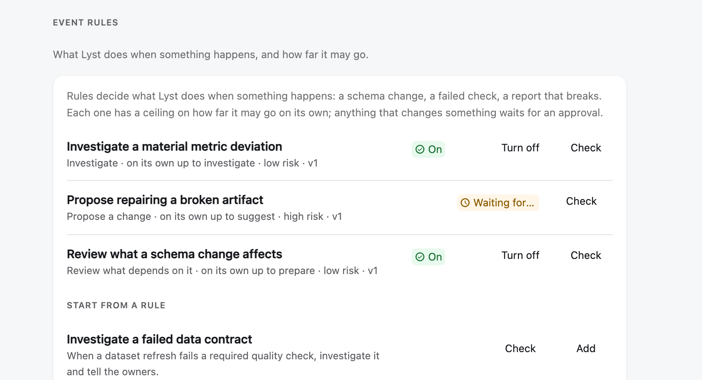<br><b>Event rules</b>: each with a ceiling, risk and approval</td>
    <td width="50%">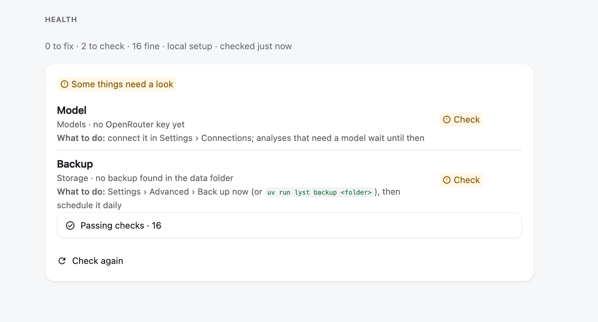<br><b>Health</b>: problems first, each with what to do</td>
  </tr>
</table>

### Governance and trust

* **Enforces data classification.** Administrators classify datasets on four levels plus personal, financial and
  regulated tags, with a reason kept for every change. A versioned policy sets who may read each level and what
  may reach an external model or an export, and it is enforced in the data service, the model gateway and the
  exporters, not in prompts: restricted data is refused with a plain "ask <owner> for access", and results from it
  never reach an external model or an exported file. Anyone can check ahead of time whether work would be allowed,
  narrowed or refused, and why; administrators also see the rule. On screen: a dataset's Overview shows its
  **Sensitivity** in words, and Settings › Privacy & Security › **Data policy** sets who reads each level and what may
  leave.
* **Explains what it asks you to approve.** Each approval and review states the action, why, what it affects
  (including reports built on a changed definition), the expected result, how to undo it, and a risk level from
  what it actually does. A "where things stand" summary tells a returning person what they asked for, what
  finished, what is running, what needs them and what comes next.
* **Accounts for cost and value.** Model cost, tokens, retries, compute and query time, rows and connector work by
  person, task, schedule, model or purpose, beside verified answers, time to a verified answer and reuse. Effort
  avoided appears only with an assumption an administrator supplies, there is never an invented ROI figure, and
  suggested savings cite the numbers behind them.
* **Guards its own quality.** Every pull request runs Lyst's evaluation suite (24 cases: 21 real questions with
  independently computed answers, including what-if and adversarial ones, plus three learning scenarios) against a
  recorded baseline. A change that makes an answer wrong, slower, or more expensive in queries, steps, model calls
  or tokens fails the build, and a planted-defect test proves the gate catches it. Runs report quality by
  dimension (completion, correctness, evidence, efficiency) and by category. Model routing learns from Lyst's own
  call records: a model that keeps failing a kind of work moves behind healthy ones (pinned models are never
  reordered), and a model registry shows each model's context, prices and reasoning settings beside its measured
  performance. Fault-injection tests break things part-way (a commit, an export that runs out of disk, an import,
  a webhook, a flood of output, corrupt workbooks, PDFs and CSVs) and check that nothing is left half done and the
  cause is stated.

### Working with others

* **Gets itself ready for a new organization.** Connect or upload data and Lyst studies the metadata only (names,
  types and shape, never rows), recognises the business areas from fourteen versioned industry packages (finance,
  procurement, sales, marketing, HR, manufacturing, customer service, product, logistics, IT, healthcare,
  professional services, financial services, small business), and suggests metrics, business terms, privacy limits for personal
  data, contracts, starter questions and sources that seem to be missing. Every suggestion says why, and none is
  official until an administrator accepts it through the usual governed, versioned and audited path. A versioned
  business profile holds the chosen industries, the organization's own words for its metrics (so "outlay"
  resolves to the approved spend metric), its fiscal year, reporting period and objectives. **Get started** is a
  short guided set-up: a progress ring counts the four essentials (connect or upload data, let Lyst study it,
  confirm the business definitions, ask a first question), the next step is lit with the sheet's one main button,
  and the optional extras (invite the team, say what matters this year, connect a model) sit apart and never
  change the count. When setup is complete, Lyst opens a one-time **You're set up** screen with how long each
  milestone took. The guide can be hidden and turned back on in Settings › Preferences, and Lyst measures time to first dataset, first analysis and first verified answer. On
  screen: **Get started** in Home's dock, **Suggestions** under the Data flow (with **Study the data again**), and
  the industry picker and **Business profile** in Settings › Workspaces ([docs/ADAPTABILITY.md](docs/ADAPTABILITY.md)).
* **Works as a team.** Comments, change requests, decisions, assignments with due dates, admin review before
  shared definitions or contracts change, sharing and ownership handover, and per-person notifications.
* **Publishes a finished answer.** **Share › Publish** turns an answer into a read-only, versioned page of the
  answer and its evidence: for members of the workspace, or, for an admin, by a link that expires (30 days by
  default). Pages carry no scripts and make no outside requests; a link is refused when the analysis read
  confidential or restricted data or the export policy says no; only the link's hash is kept; and a page can be
  republished with a newer answer or revoked at once.
* **Speaks to the rest of your stack.** Every change in a workspace, from a new dataset version to a finished
  analysis, a contract check or an approval, becomes one event with a stable id. Stream the events, or have them
  delivered as signed webhooks with retries, dead-lettering and replay; webhooks never reach private network
  addresses. The Python SDK `lyst-client` (`pip install ./sdk/python`) covers files, questions, SQL, events and
  webhooks with typed errors and safe retries, and a recorded API contract keeps the HTTP API from breaking
  callers. The MCP server marks which tools only read, audits every call, keeps results within a size budget, and
  can read files and report what changed. Admins manage webhooks in Settings › Connections › **Webhooks** (Test,
  Pause, a delivery log with resend, and a signing secret shown once).
* **Moves a whole workspace in one sealed file.** Datasets and their versions, definitions, knowledge, dashboards
  and reports, members and history travel in one file encrypted with a passphrase; any tampering or truncation is
  caught before anything is read. Credentials never travel, and data your policy keeps inside the workspace cannot
  be exported this way either. Importing always creates a new workspace, checks every part first, and arrives with
  its schedules paused, so a copy never runs the same work twice. In Settings › Workspaces › **Move or copy this
  workspace**, you seal the workspace into a passphrase-protected pack and download it; on another installation an
  admin checks the pack and brings it in as a new workspace, with schedules paused unless they choose otherwise.

<p align="center">
  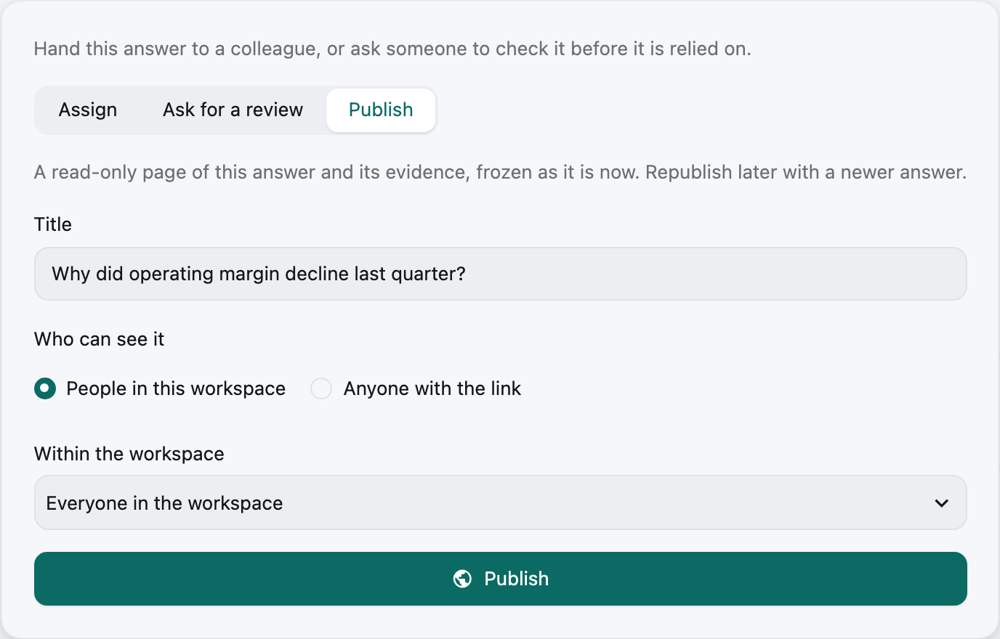
</p>

### Running it

* **Locale and accessibility helpers, ready for the interface.** `src/lyst/i18n.py` formats numbers, currency,
  percentages, compact units and dates for en-US, en-GB, de-DE, fr-FR, es-ES, pt-BR, ja-JP and hi-IN (with lakh
  grouping), rounds half up, uses a real minus sign so screen readers say "minus", and never shows a negative zero
  (`LYST_LOCALE`). It also checks WCAG 2.2 AA contrast and writes plain-language descriptions of charts and tables
  for screen readers and alt text. The helpers are tested but the interface does not use them yet; raw data is
  never changed by them, only how it is shown.
* **Fits how you deploy.** `LYST_PROFILE` picks `local` (the default), `offline` (a local model only, no catalog
  refresh or telemetry, webhooks to private addresses only), `server` (all interfaces, with OIDC and TLS expected
  at the proxy) or `portable` (a self-contained data folder that moves as a workspace pack). `lyst doctor` checks
  the installation end to end (packages, disk, encryption, migrations, backups, the credential audit chain,
  network exposure, the sandbox, the model, stalled work, and the profile's own promises) and gives the fix for
  each, with no key, token, path or data in its report. Settings › Advanced › **Health** shows the same checks,
  problems first, each with what to do. An air-gapped Compose stack is in `deploy/offline/` (written, not yet
  run).
* **Recovers from the worst day.** Backups never contain the master key, and are atomic (a full disk partway
  through leaves no half backup) and can run on a schedule. Every new backup gets a restore drill that checks each
  checksum, refuses a backup containing key material, and opens every database with the current master key. Lyst
  reports the measured recovery point and recovery time against your targets, shown with **Back up now** in
  Settings › Advanced › Backups and recovery ([docs/OPERATIONS.md](docs/OPERATIONS.md)).

<table>
  <tr>
    <td width="50%"><br><b>Recurring</b>: calendar schedules with their next run</td>
    <td width="50%"><br><b>Usage & limits</b>: spend and work against the limits</td>
  </tr>
  <tr>
    <td colspan="2" align="center">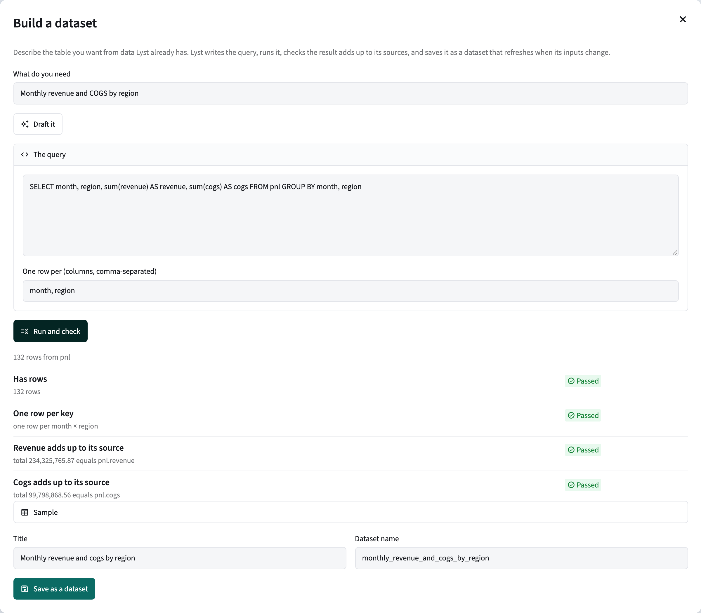<br><b>Build a dataset</b>: checked before it is saved</td>
  </tr>
  <tr>
    <td width="50%">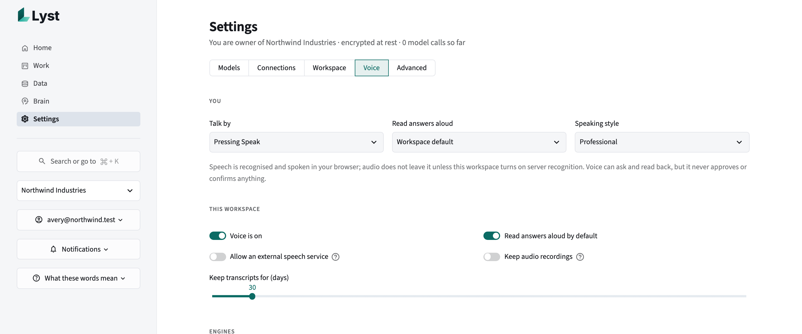<br><b>Settings › Models & Voice</b>: your mode, the workspace's rules, honest engine labels</td>
    <td width="50%">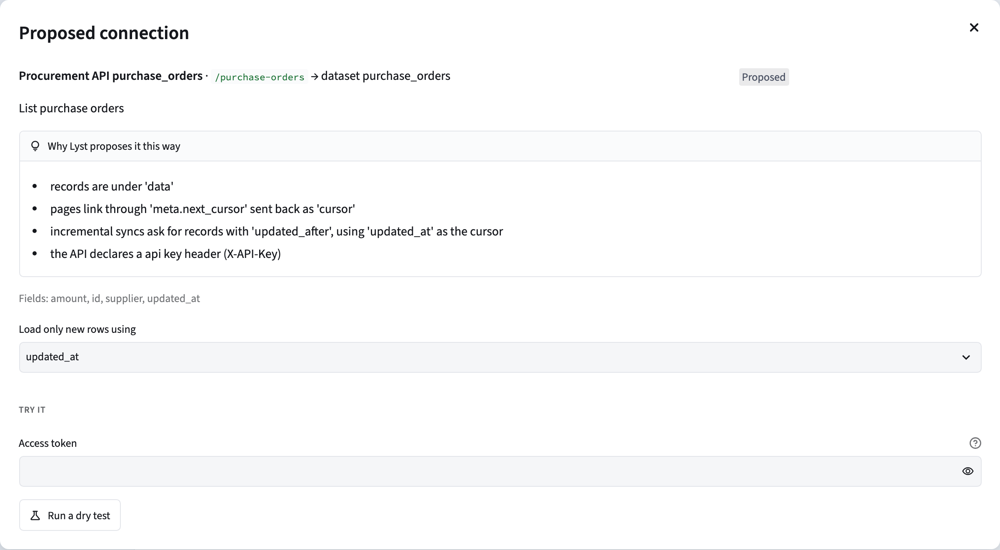<br><b>Proposed connection</b>: drafted from an API description, tested dry</td>
  </tr>
  <tr>
    <td width="50%">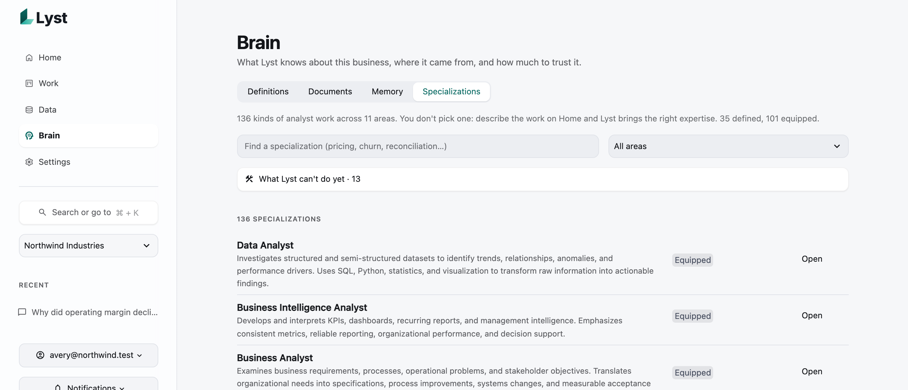<br><b>Brain › More › Specializations</b>: 136 profiles, honest maturity</td>
    <td width="50%">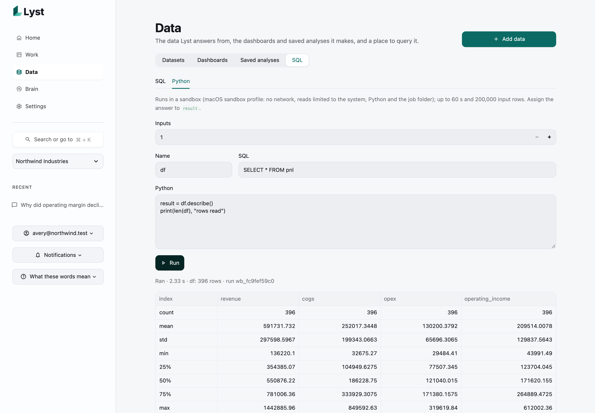<br><b>Python workbench</b>: sandboxed, recorded, reproducible</td>
  </tr>
  <tr>
    <td colspan="2" align="center">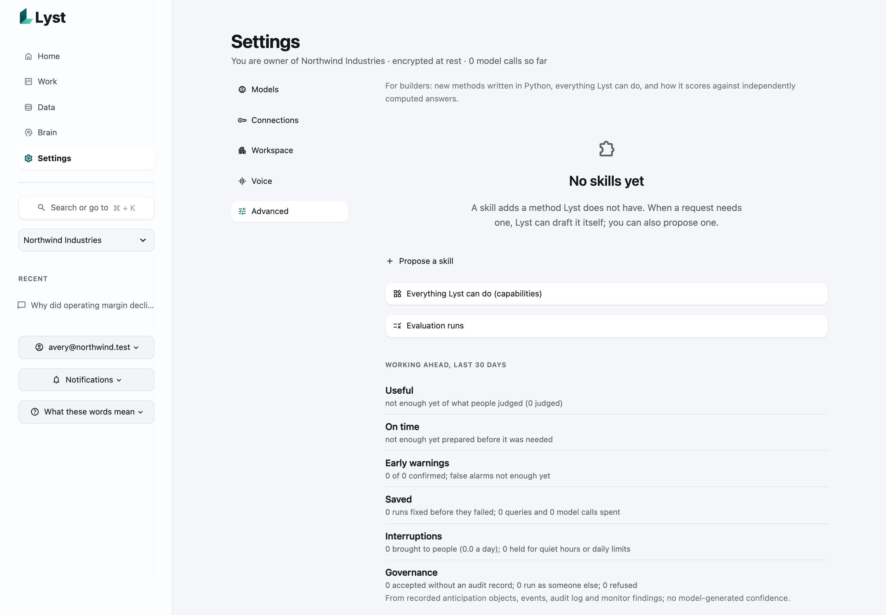<br><b>Working ahead, last 30 days</b>: measured from what actually happened</td>
  </tr>
</table>

The [capability matrix](docs/CAPABILITY_MATRIX.md) lists each capability with its state and the test that proves
it, and [known gaps](docs/GAPS.md) lists what is missing.

## Build on Lyst with the AI SDK

Lyst's engine speaks the [AI SDK](https://ai-sdk.dev)'s own wire format, the UI message stream, so any AI SDK client
(`useChat`, `Chat`, `readUIMessageStream`) can ask Lyst and watch the work. Every model call still goes through
Lyst's own gateway, guard and receipts. Node is used only to build and test the client pieces, and the package's own
parser checks Lyst's stream in CI (`ai` 7.0.165).

```ts
const { messages, sendMessage, addToolApprovalResponse } = useChat({
  id: chatId,
  resume: true,
  transport: new DefaultChatTransport({
    api: `${LYST}/v1/workspaces/${ws}/chat`,
    headers: { Authorization: `Bearer ${token}` },
  }),
});
```

- **Answers that stream as they are written, each figure checked first.** One message is one Lyst task: each step
  arrives as a tool part, the datasets read as sources, and the answer as text while the model writes it. A
  figure is shown only once it matches a value Lyst computed (read with its unit and scale), and the first figure
  that does not stops the draft. The stored, verified answer has the last word: a draft that differs from it is
  withdrawn and replaced. A stream cut by a reload resumes.
- **A live answer component.** A Streamlit component runs the AI SDK client in the browser and draws the status,
  each step and what it worked on, the answer forming, the datasets read and any approval waited on, then offers
  **Open answer**. The browser never holds the person's session, only a 15-minute chat ticket that opens one
  workspace's chat routes, acts as that person under every permission check, and stops working when the engine
  restarts.
- **Lyst Apps.** One sentence ("an app to watch operating margin and revenue by region") becomes a small interactive
  app built block by block as the model writes it: KPIs, trends, breakdowns, tables, a filter, a what-if and notes.
  The app is a spec from a closed catalog, never code, and the model never supplies a number: every value comes
  from an approved metric through the semantic layer's SQL, a filter narrows with Lyst's own per-value figures, and
  the what-if is labelled "Projection, not data". Apps are drawn in a locked-down sandbox (no network, storage or
  page access), follow light and dark, work without a model (the rules build one from the metrics you name), and
  are saved as versioned assets that flag themselves when a metric they use is redefined.
- **Approvals in the chat.** A step that needs a person arrives as the AI SDK's own tool approval, and any client
  answers it with `addToolApprovalResponse`. Lyst applies the answer only as the person who sent it, under the same
  role checks as everywhere else (a capability's proposer still cannot approve it), then continues the same message
  with the answer. A chat ticket can ask and watch but never approve.

The live answer and Lyst Apps are built and tested as components but are not placed on a page yet; today they are
reached through the API. See [docs/AI_SDK.md](docs/AI_SDK.md) for the stream mapping, the routes and the build.

## Models

Lyst calls models through OpenRouter on a gateway ported from Acumane's: workload routing, admission, adaptive
limits, retries with fallback, and the cost of every call. Each workspace picks a level, built daily from
OpenRouter's live catalog:

| Level | Models | Use it for |
|---|---|---|
| **Economy** | Each provider's fast line (Claude Haiku, GPT mini, Gemini Flash Lite, …) | High volume, simple questions |
| **Balanced** (default) | The mid lines (Claude Sonnet, Gemini Flash, Mistral Large, …) | Most work |
| **Frontier** | The flagships (Claude Opus, the newest GPT, Gemini Pro, Grok) | Hard investigations |

An administrator sets the default level and a ceiling; a workspace admin can also choose one specific model.
Settings › Models & Voice shows each level's models, OpenRouter's prices, the cost per call and per 1,000 calls, and
30-day spend. Quick steps such as classification run with thinking off, and an empty reply fails over to the
next model, so the computed answer always stands.

A local OpenAI-compatible server (Ollama, llama.cpp, vLLM) works instead: set `LYST_LLM_BASE_URL` and
`LYST_LLM_MODEL`. Details are in [docs/MODELS.md](docs/MODELS.md).

## Security and secrets

* **Credentials are never configuration.** The OpenRouter key, database passwords and API tokens are entered
  once in **Settings › Connections**, tested, sealed with AES-256-GCM envelope encryption, and never
  shown again. `.env` files refuse secret-shaped names. OpenBao is supported for enterprises.
* **The master key lives outside the data**: in the OS credential store (the Keychain on a Mac), a mounted
  secret file, or OpenBao, and never beside the database. `lyst init` sets it up and `lyst rotate-master-key`
  re-keys everything.
* **Encrypted at rest.** Every workspace is its own encrypted DuckDB file with a derived key.
* **Governed access.** Roles, workspace isolation, a read-only SQL guard with column and row policies, redaction
  before text reaches an external model (dataset rows are never sent), OIDC sign-in, and a hash-chained credential
  audit trail. OIDC sign-in hands the browser a one-time code, never the token, and `lyst init` and `lyst
  rotate-master-key` show a key only on a terminal (otherwise they need `--out FILE`, written owner-only).

The threat model, autonomy levels and residual risks are in [docs/SECURITY.md](docs/SECURITY.md).

## Commands

| Command | What it does |
|---|---|
| `lyst start [--demo] [--no-browser] [--check]` | Everything in one terminal: encryption, the engine and the interface; safe to rerun. `--check` only runs the start checks |
| `lyst status [--json]` | Whether Lyst is running here, at which address, and under which PIDs |
| `lyst stop` | Stop the Lyst that `lyst start` launched here; never touches processes it didn't record |
| `lyst init-demo` | Create the Northwind demo workspace and a development token |
| `lyst serve` | Run the API and workers (`http://127.0.0.1:8770`) |
| `lyst ui` | Run the Streamlit interface (`http://lyst.localhost:8501`, loopback only by default) |
| `lyst token EMAIL [--owner-of WS]` | Issue an API token, optionally creating a workspace with that user as owner |
| `lyst init [--recovery]` | Initialise encryption, or restore a saved master key |
| `lyst rotate-master-key` | Re-key every database and re-wrap every secret (engine stopped) |
| `lyst doctor [--json] [--no-network]` | Check the whole installation and say how to fix each problem |
| `lyst export WS FILE [--history]` | Seal a workspace into a passphrase-protected pack |
| `lyst import FILE [--as ID] [--activate] [--check]` | Check a pack and bring it in as a new workspace, schedules paused |
| `lyst backup DEST` | Consistent, encrypted backup, also while the engine is running |
| `lyst restore SRC` | Verified restore into `LYST_HOME` (engine stopped) |
| `lyst prune` | Apply retention to events, calls, query history and notifications |
| `lyst eval` | Score the analytical question bank against independent answers |

Prefix each with `uv run` in a checkout. Ports move with `LYST_PORT` and `LYST_UI_PORT`, and data lives in
`LYST_HOME` (default `./var`). Other settings are environment variables documented at the top of
[`src/lyst/config.py`](src/lyst/config.py).

## Development

```bash
uv run pytest                        # the full suite; the PostgreSQL connector test uses a local server
uv run lyst eval --baseline docs/quality/eval-baseline.json   # 24 cases scored against independent answers and the baseline
uv run ruff check src tests scripts  # lint
uv run python scripts/licenses.py    # regenerate docs/SBOM.md and fail on a disallowed license
```

CI runs all four on every pull request and every push to main.

| Path | What |
|---|---|
| `src/lyst/` | The product: store, security, secrets, data, semantic, analyst, runtime, llm, api, ui, dashkit |
| `tests/` | Unit and acceptance tests, including the adversarial scenarios |
| `docs/` | Architecture, models, security, capability matrix, excellence registers, decisions |
| `scripts/` | License gate, load test and benchmarks |
| `site/` | The marketing website (a separate build; see its README) |

To run on a server, see [docs/DEPLOYMENT.md](docs/DEPLOYMENT.md) (Docker Compose, non-root, read-only).

## Documents

[Architecture](docs/ARCHITECTURE.md) · [Data platform](docs/PLATFORM.md) · [Capability matrix](docs/CAPABILITY_MATRIX.md) ·
[Models](docs/MODELS.md) · [Security](docs/SECURITY.md) · [Connectors](docs/CONNECTORS.md) ·
[Skills](docs/SKILLS.md) · [DuckDB design](docs/DUCKDB.md) · [Deployment](docs/DEPLOYMENT.md) ·
[Performance](docs/PERFORMANCE.md) · [Operations](docs/OPERATIONS.md) · [Anticipation](docs/ANTICIPATION.md) · [Adaptability](docs/ADAPTABILITY.md) · [Extensibility](docs/EXTENSIBILITY.md) · [Specializations](docs/SPECIALIZATIONS.md) · [Specializations audit](docs/SPECIALIZATIONS_AUDIT.md) · [Graph runs](docs/GRAPH_RUNS.md) · [Learning](docs/LEARNING.md) · [Events](docs/EVENTS.md) · [Harness](docs/HARNESS.md) · [Voice](docs/VOICE.md) · [AI SDK](docs/AI_SDK.md) · [UX strategy](docs/UX_STRATEGY.md) · [Product excellence](docs/PRODUCT_EXCELLENCE.md) ·
[Engineering excellence](docs/ENGINEERING_EXCELLENCE.md) · [Known gaps](docs/GAPS.md) ·
[Roadmap](docs/ROADMAP.md) · [Acumane audit](docs/ACUMANE_AUDIT.md) · [SBOM](docs/SBOM.md) ·
[Decisions](docs/decisions/)

## License

[GNU AGPL-3.0-only](LICENSE). If you run a modified Lyst as a network service, you must offer its users the
modified source (AGPL section 13). Every dependency is AGPL-compatible ([SBOM](docs/SBOM.md)). Vendored analytics
in `src/lyst/analytics/` come from the same author's ai-analytics project and are relicensed with Lyst.
