<p align="center">
  
</p>

<p align="center">
  <b>An AI analyst that does the work, checks its own numbers, and shows you the evidence.</b><br>
  Self-hosted · Python 3.12+ · DuckDB · Streamlit · FastAPI · AGPL-3.0-only
</p>

<p align="center">
  <a href="https://github.com/MoRohn/lyst/actions/workflows/ci.yml"></a>
  <a href="https://morohn.github.io/lyst/">Website</a> ·
  <a href="docs/CAPABILITY_MATRIX.md">What works today</a> ·
  <a href="docs/ARCHITECTURE.md">Architecture</a> ·
  <a href="docs/SECURITY.md">Security</a>
</p>

---

You describe a question or a piece of work. Lyst plans it, runs it on approved data definitions with SQL and
Python, verifies the result independently, and returns a decision-ready answer with every query, check and
assumption behind it. It is judged by completed, verifiable work, not by conversation: every number comes from
a query, whether or not a model is involved.

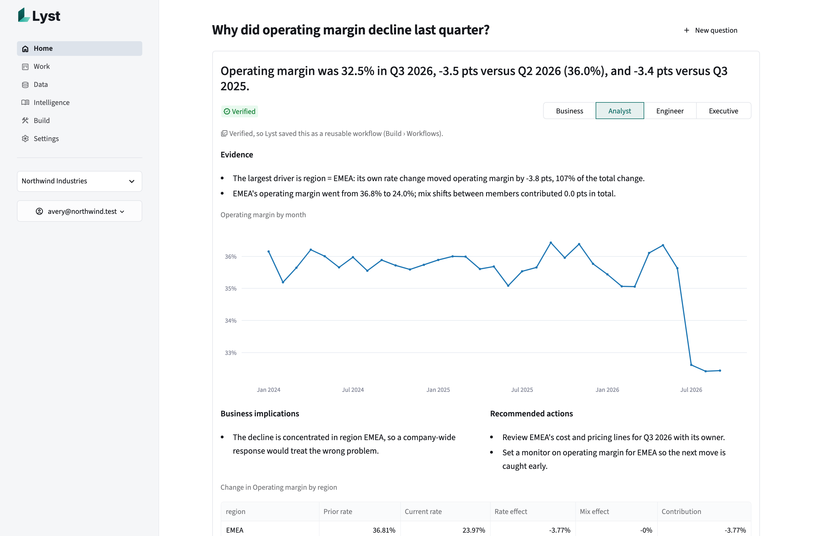

## Quick start

You need [uv](https://docs.astral.sh/uv/) on macOS or Linux.

```bash
git clone https://github.com/MoRohn/lyst.git && cd lyst
uv sync --all-extras
uv run lyst start --demo
```

One command initialises encryption (the master key goes into the OS credential store), seeds the Northwind
demo workspace, starts the engine on `http://127.0.0.1:8770` and opens the interface at
**http://lyst.localhost:8501**. Ctrl-C stops everything.

Then ask: **"Why did operating margin decline last quarter?"** Lyst finds that operating margin fell from 36.0%
in Q2 2026 to 32.5% in Q3 2026, that EMEA's own margin drop (36.8% to 24.0%) explains it, reconciles the
bridge exactly, and saves the analysis so it can be rerun for any period. That story is planted in the demo data
(`src/lyst/demo.py`) so the tests can check that Lyst recovers it.

No model is needed to try it. With none configured, Lyst runs on rules and templates; adding one improves
understanding and wording, never the numbers.

## A tour of the interface

One navigation with five areas, light and dark themes, and in the sidebar a search box across data, metrics,
saved work and documents, plus a "What these words mean" glossary.

| Area | What you do there |
|---|---|
| **Home** | Ask in plain words, follow live progress, and read the answer. A Get started card guides the first run, and "This month at a glance" shows a tile per approved metric with a one-click **Why?** |
| **Work** | What needs you (approvals), what Lyst is doing and finished, and what runs on its own: watched metrics, scheduled questions and what Lyst noticed |
| **Data** | Datasets with a trust chip each, their sources, dashboards, saved analyses, and guarded SQL. **Add data** uploads a file or connects a source |
| **Brain** | What Lyst knows about the business: approved metrics and business terms with their health and lineage, documents it can cite, and what it remembers and how far to trust it |
| **Settings** | Models (level and costs), Connections (keys and sources), Workspace (members, autonomy, audit trail) and Advanced (skills, capabilities, evaluation runs) |

<p align="center">
  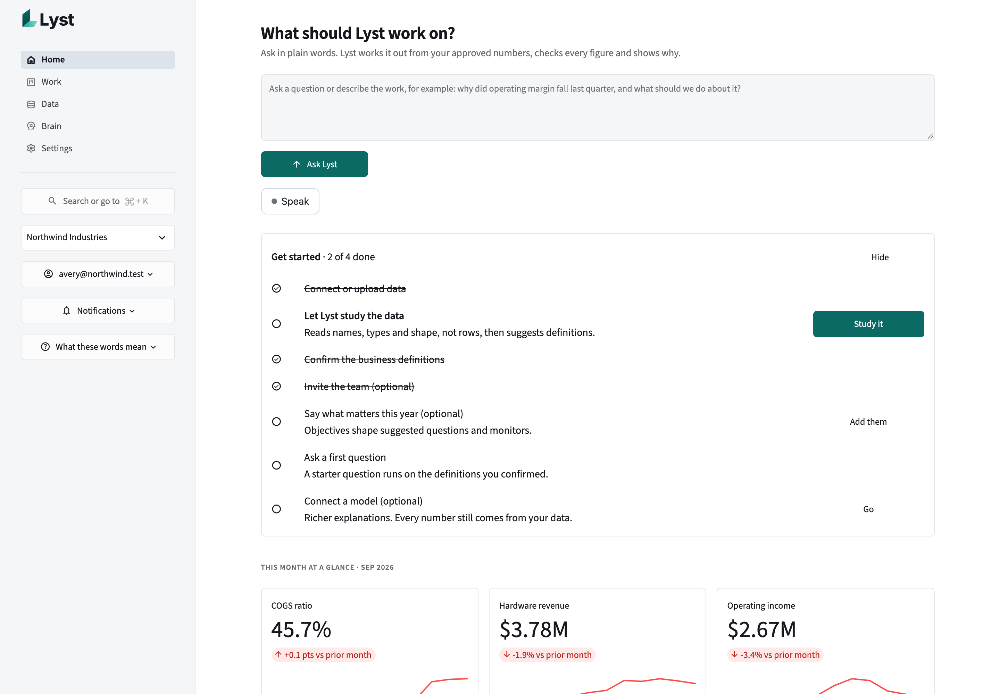
</p>

### Every answer: Summary, Detail, Method, and a Brief

Answers open at **Summary**: the answer, a one-line trust statement ("All 9 checks passed"), the evidence, a
chart, what it means and what to do. **Detail** adds tables, hypotheses, assumptions and sources. **Method** adds
the plan, every check and every query. **Brief** opens the two-line version with one chart, what to do and the PDF
briefing, ready to forward; executive requests lead with it. Limitations stay visible at every depth.

Under each answer you can act on it: **Watch this metric** sets up a monitor, **Repeat it** reruns the saved
analysis on a schedule, **Download** gives a PDF briefing, a deck, an Excel workbook or Markdown, **Share** assigns
it to a colleague or asks for a review, **Discuss** opens its thread, and **How this ran** shows each step, query
and model call with its timing.

<p align="center">
  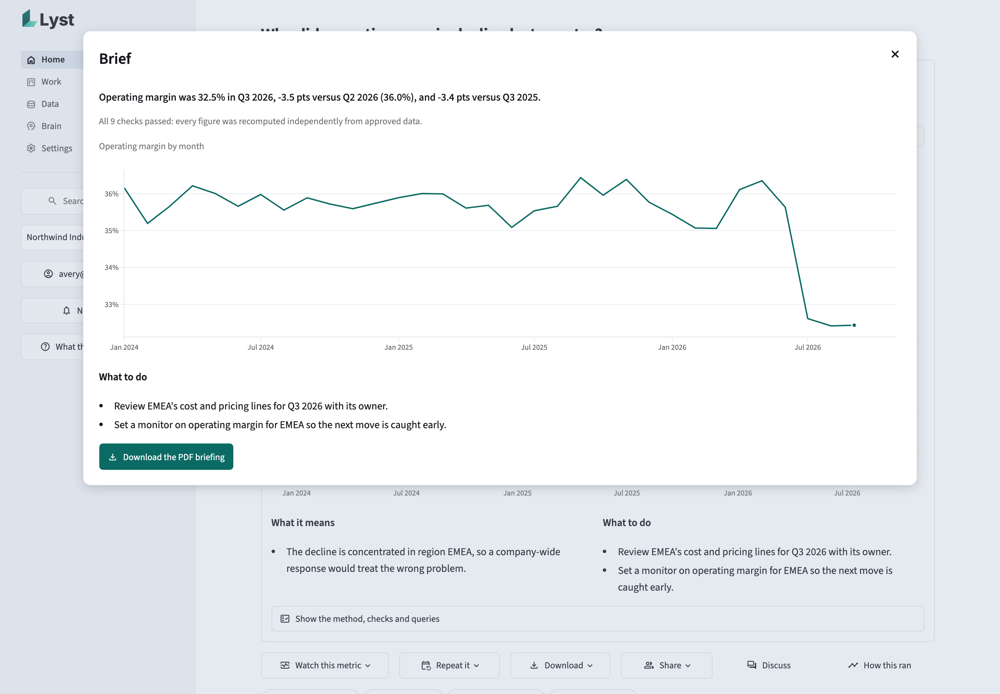
  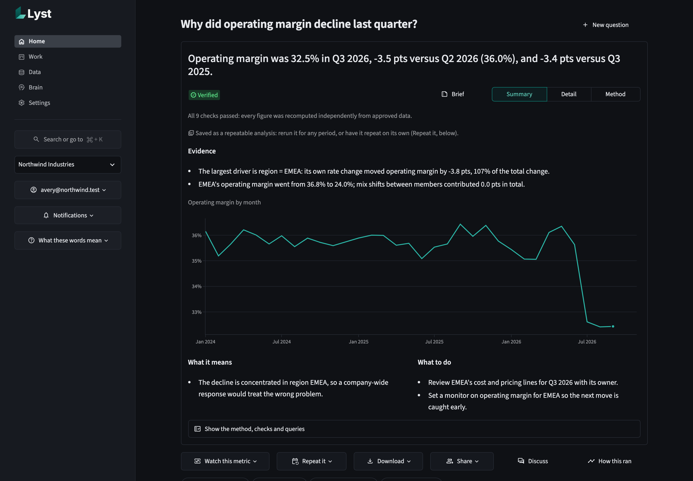
</p>

<table>
  <tr>
    <td width="50%">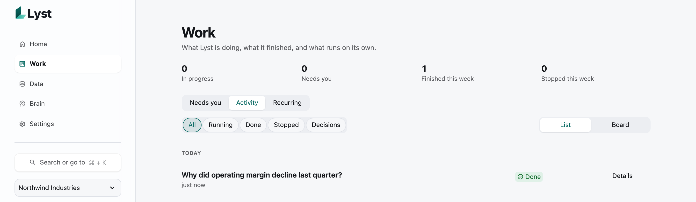<br><b>Work</b>: needs you, activity and recurring runs</td>
    <td width="50%">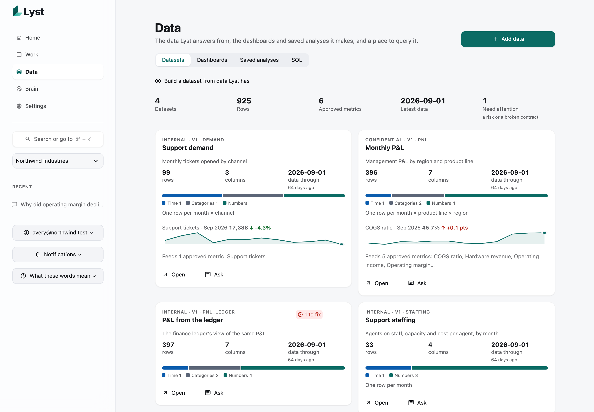<br><b>Data</b>: datasets, dashboards, saved analyses and SQL</td>
  </tr>
  <tr>
    <td>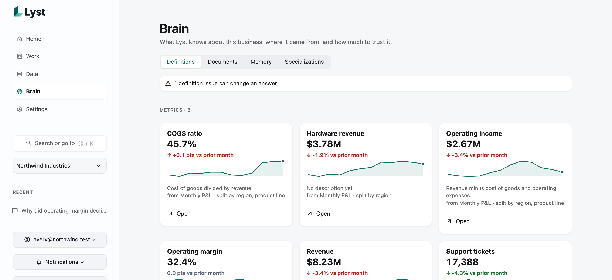<br><b>Brain</b>: definitions, documents and memory</td>
    <td>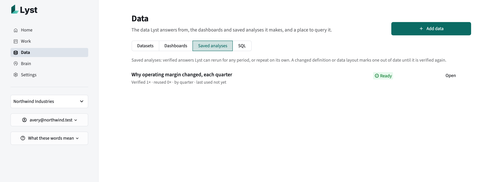<br><b>Saved analyses</b>: verified work Lyst reruns for any period</td>
  </tr>
</table>

### What if?

Ask a what-if in plain words on Home, such as "What happens to operating margin if labor costs increase 6% while
revenue grows 3%?". Lyst answers from a driver model whose observed inputs are read from governed data for a named
period, with your own permissions, and whose assumptions carry a plausible range. The answer is labelled
hypothetical, lists the observed inputs (period, dataset version, data-through date), the assumptions and the
formulas as evidence, and is recomputed independently. Changes can be given as percentages or in points ("COGS
ratio rises 2 points"). A driver the model does not have is listed as "Not modelled", never guessed, any change
Lyst could not apply is stated, and such an answer is never marked Verified. From there: tornado sensitivity, best, base and worst cases, a seeded Monte Carlo (P5,
P50, P95 and the chance of falling below a threshold), and saved scenarios that can be rerun and compared, with
any drift reported.

On an answer whose metric has a driver model, **What if…? Explore** opens sliders for each driver, shows base →
scenario marked Better or Worse, where the starting figures come from, **How sensitive is it?** and **Save this
scenario**. Saved scenarios live in Data › Saved analyses › Scenarios with Explore, Open and Re-run.

Decisions get the same care. Lyst tells an analytical question apart from a decision that needs authority,
compares options on weighted criteria and constraints under uncertainty, finds where the leading option would
change, and allocates budgets with an exact solver. It says "insufficient evidence" or "no clear winner" rather
than claim one. A **decision record** goes from analyzed to submitted to approved or rejected by a person, who
may pick a different option, and is later reviewed against what actually happened. Nothing is executed. Editors
start one with **Compare options** on an answer, and records are listed in Work › Activity › Decisions.

<table>
  <tr>
    <td width="45%">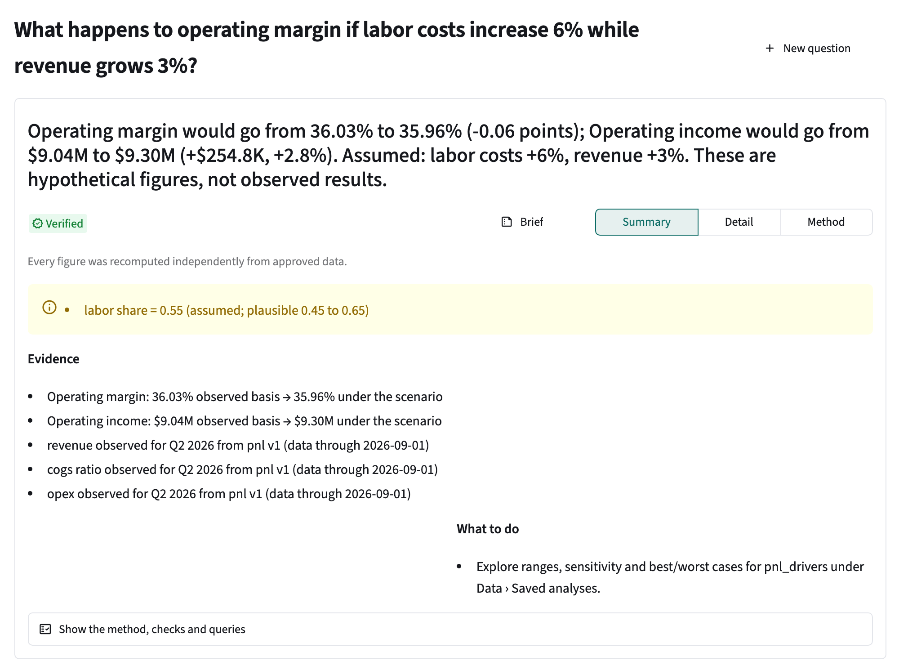<br><b>A what-if answer</b>: hypothetical, with its inputs</td>
    <td width="55%">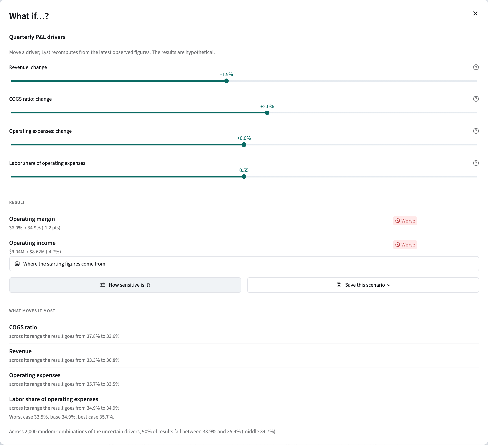<br><b>What if…?</b>: move the drivers, see what moves it most</td>
  </tr>
</table>

### Dashboards from a sentence

Data › Dashboards › **New dashboard** turns a request into a Plotly Dash app on Lyst's own kit
(`src/lyst/dashkit`, vendored into each app so it runs anywhere with PyPI packages only): governed metrics,
verified SQL, KPI cards, a trend with a forecast band, click-to-filter breakdowns, and a Data and method page.
Every generated app is checked in a separate interpreter before it is offered.

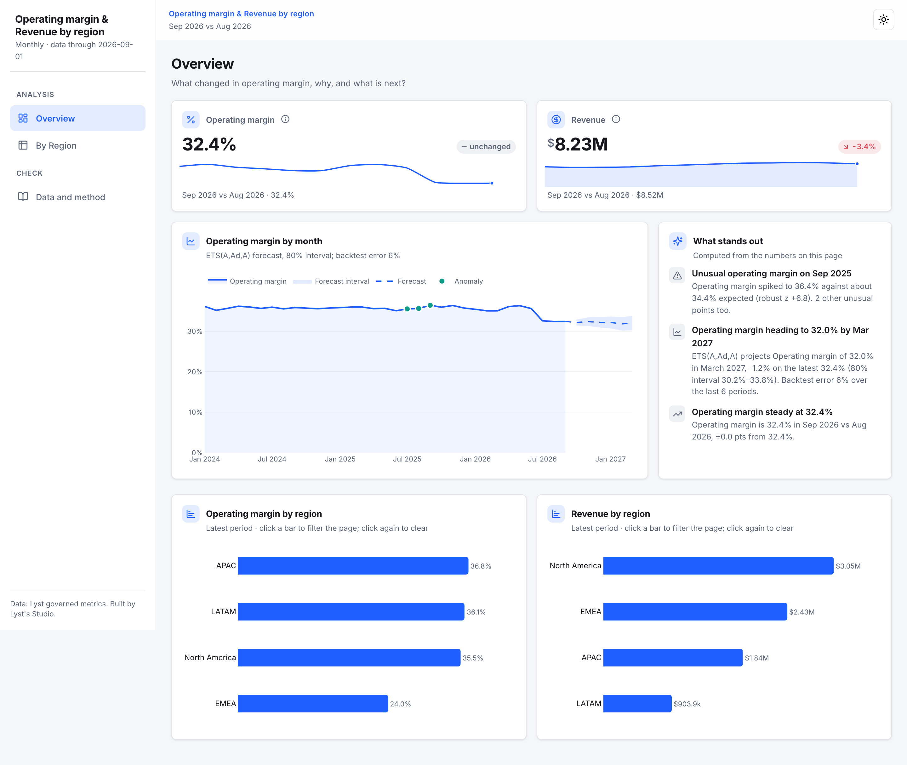

### A look before loading

**Add data › Upload a file** reads spreadsheets, CSV and other tables, and documents, then shows what it found
before anything loads: each table with its rows, sheet and range, whether a total row adds up, notes and a
preview. Keep or drop each table, name it, then **Load it** or **Discard**.

<p align="center">
  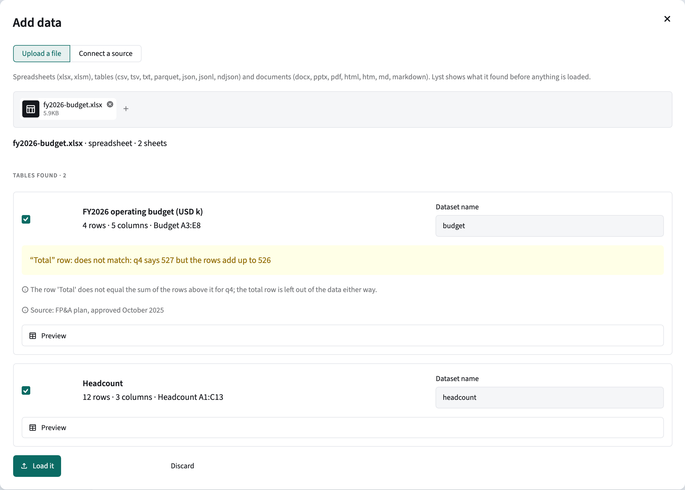
</p>

### Lyst knows your data

Every dataset version is profiled on arrival. Lyst learns its grain, keys and column meaning, finds duplicates at
the grain, outliers, concentrated missing values, time-series gaps and stale data, and ranks what to check
before relying on it. Each dataset in Data carries a chip (**Trusted**, **N to fix**, **Contract broken**), and
its Overview shows those risks, what depends on it, and how it connects to other data: key candidates, shared
dimensions, and overlapping sources reconciled by their totals.

* **Data contracts.** Lyst drafts a contract from the data (columns, types, allowed values, what identifies a
  row). Once adopted, it is versioned and checked on every refresh. A breaking change upstream is flagged with
  the metrics, dashboards and saved analyses it affects, and reaches the owners' inbox once.
* **Metric lineage.** Each definition shows where its number comes from (source, freshness, contract), its
  versions with field-level changes, and what uses it. Retiring a definition can name a replacement that
  requests and terms then follow. A definitions health line in Brain lists duplicates, conflicting sources,
  ambiguous synonyms and stale definitions, each with its fix.
* **Search** across datasets, columns, metrics, terms, saved analyses, dashboards, documents and earlier
  answers, filtered by what you may see. Each result opens where it lives.

<table>
  <tr>
    <td width="50%">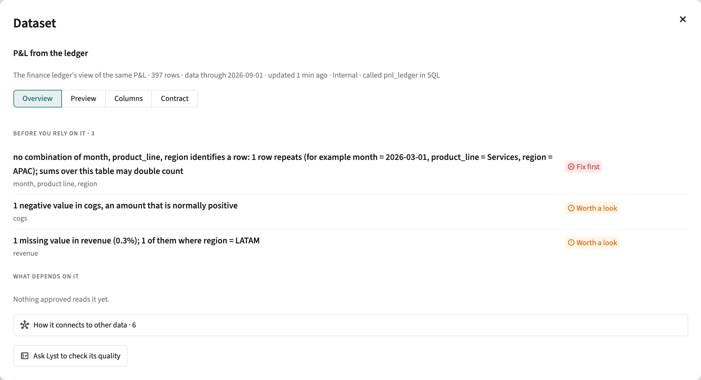<br><b>Before you rely on it</b>: ranked risks found in the data</td>
    <td width="50%">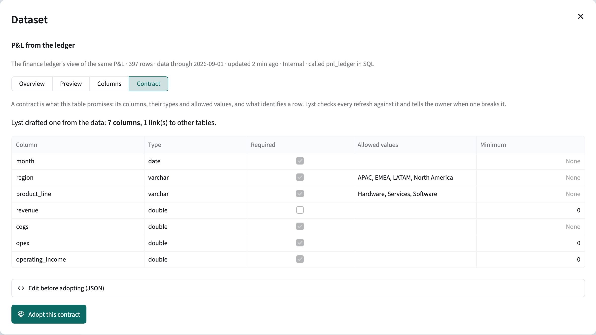<br><b>Contract</b>: drafted from the data, adopted in one click</td>
  </tr>
  <tr>
    <td colspan="2" align="center">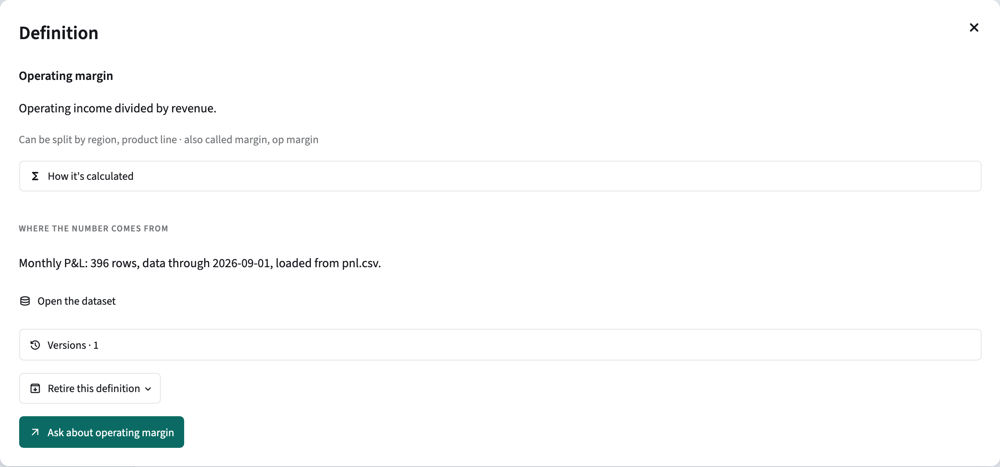<br><b>Definition</b>: where the number comes from, versions and retirement</td>
  </tr>
</table>

### Sources that tell you what is wrong

Data › Datasets › **Sources** lists each connection with a health chip (**Healthy**, **Degraded**, **Failing**,
**Needs action**, **Not tested**). When something is wrong, the row says the one thing to do instead of the
usual details. A source's dialog shows the cause in plain words (sign-in, permissions, rate limit, time-out, the
source itself), the last 24 hours of operations, errors and retries, every table it feeds with its sync mode,
freshness, schedule and contract, and the credential's status (never the secret), with Test and Sync at hand.

<table>
  <tr>
    <td width="45%">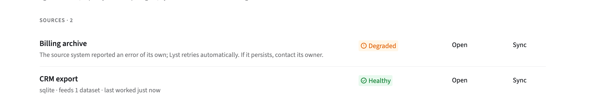<br><b>Sources</b>: one chip and one action per connection</td>
    <td width="55%">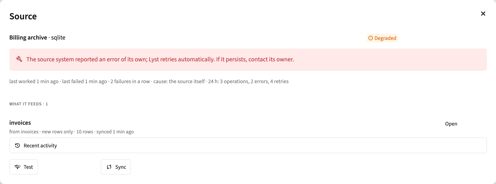<br><b>A degraded source</b>: the action, the cause and what it feeds</td>
  </tr>
</table>

### What Lyst makes stays current

Reports (PDF briefings, workbooks, decks), dashboards and saved analyses share one registry with an owner,
versions, validation status, and the question, dataset versions and metric versions each was built from. Every
new data load and definition change re-assesses them, and the owner hears once when one stops matching the data.

In Data › Dashboards and Saved analyses, a row gets a chip only when it needs attention: **Out of date** (newer
data), **Needs rebuilding** (a definition changed), **Broken** (an upstream contract break) or **Updating**.
**Reports from answers** lists every briefing, deck and workbook downloaded from an answer, with **Check all**.
Opening one says why in words and offers one button: **Refresh it** for a dashboard (the previous version is
kept) or **Rebuild it** for a report or saved analysis, which reruns the question on current data. Only a verified
result becomes a new version; a failed repair restores the earlier state with the reason, and a cause upstream
says a person is needed.

<table>
  <tr>
    <td width="45%">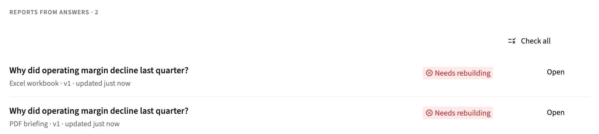<br><b>Reports from answers</b>: health at a glance</td>
    <td width="55%">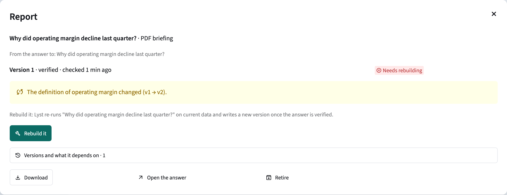<br><b>Needs rebuilding</b>: the reason and one-click repair</td>
  </tr>
</table>

### Working as a team

* **Discuss anything.** Comments, replies and `@mentions` on an investigation, analysis, report, metric or
  dataset; **change requests** that stay open until resolved; and **decisions** recorded and listed across the
  workspace. A private report's thread is exactly as private as the report.
* **Assign work** with a note and a due date; the assigner hears when it is done.
* **Reviews before shared changes.** An editor can propose a metric definition, a data contract or publishing a
  private report; nothing applies until an admin other than the proposer approves it, and the review is kept in
  the metric's history and the audit log.
* **Sharing and ownership.** Reports are private, shared with named people, or visible to the workspace, and
  ownership of reports, datasets and metrics can be handed over.
* **Your notifications, your way.** Mentions, assignments, reviews, decisions and comments on what you own
  arrive in one list with platform notices, and each kind can be switched off per person.

On screen: **Share** and **Discuss** sit on every answer; **Work › Needs you** adds *Assigned to you* (Open, Done)
and *Reviews waiting* (Open, Approve, Reject), counted in the sidebar; and **Notifications** in the sidebar open
where they point, with Mark all read and "What to tell me about".

<table>
  <tr>
    <td width="45%">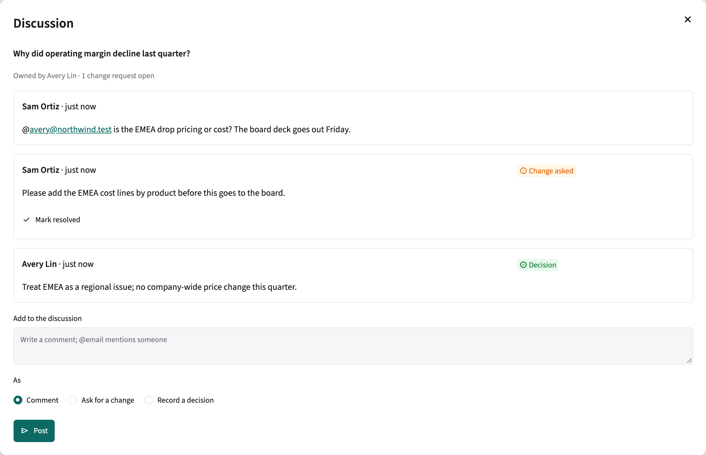<br><b>Discuss</b>: comments, change requests and decisions</td>
    <td width="55%">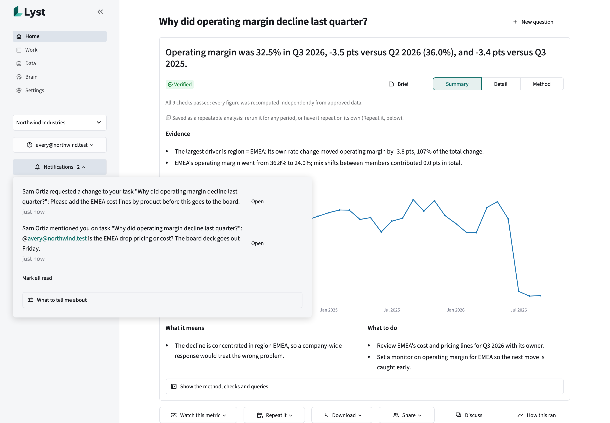<br><b>Notifications</b>: open where they point</td>
  </tr>
</table>

## What Lyst does

* **Gets itself ready for a new organization.** Connect or upload data and Lyst studies the metadata only (names,
  types and shape, never rows), recognises the business areas from thirteen versioned industry packages (finance,
  procurement, sales, marketing, HR, manufacturing, customer service, product, logistics, IT, healthcare,
  professional services, financial services), and suggests metrics, business terms, privacy limits for personal
  data, contracts, starter questions and sources that seem to be missing. Every suggestion says why, and none is
  official until an administrator accepts it through the usual governed, versioned and audited path. A versioned
  business profile holds the chosen industries, the organization's own words for its metrics (so "outlay"
  resolves to the approved spend metric), its fiscal year, reporting period and objectives. A short guided set-up
  shows what to do next, and Lyst measures time to first dataset, first analysis and first verified answer.
  Available through the API; screens are on the way ([docs/ADAPTABILITY.md](docs/ADAPTABILITY.md)).
* **Answers and investigations.** Values with prior-period and year-ago comparisons, breakdowns, trends,
  anomalies, forecasts with backtests, "why" questions with exact rate and mix attribution, deep investigations
  that decide between competing hypotheses by computation, staffing scenarios under uncertainty, and event
  impact with stated assumptions.
* **Checks its own work.** Independent validation scaled to consequence (high-stakes answers are recomputed from
  raw rows in pandas), join fan-out and stale-source detection, ambiguous terms surfaced instead of guessed, and
  model wording verified against the computed numbers.
* **Shows its working on request.** Any figure in an answer or a generated report traces back through the step
  that computed it, the SQL that ran, the metric version and the dataset version (rows, checksum, load time,
  classification) to its source, with the checks, assumptions, citations and approvals involved. A figure counts as
  traced only when a stored result backs it at the precision written. Ask how it was figured, what it rests on,
  what would change it, or have Lyst reproduce it under your current permissions; the answers come from those
  records, not invented explanations, and Lyst says when the data behind an answer has a newer version.
* **Enforces data classification.** Administrators classify datasets on four levels plus personal, financial and
  regulated tags, with a reason kept for every change. A versioned policy sets who may read each level and what
  may reach an external model or an export, and it is enforced in the data service, the model gateway and the
  exporters, not in prompts: restricted data is refused with a plain "ask <owner> for access", and results from
  it never reach an external model or an exported file. Anyone can check ahead of time whether work would be
  allowed, narrowed or refused, and why; administrators also see the rule.
* **Explains what it asks you to approve.** Each approval and review states the action, why, what it affects
  (including reports built on a changed definition), the expected result, how to undo it, and a risk level from
  what it actually does. A "where things stand" summary tells a returning person what they asked for, what
  finished, what is running, what needs them and what comes next.
* **Accounts for cost and value.** Model cost, tokens, retries, compute and query time, rows and connector work by
  person, task, schedule, model or purpose, beside verified answers, time to a verified answer and reuse. Effort
  avoided appears only with an assumption an administrator supplies, there is never an invented ROI figure, and
  suggested savings cite the numbers behind them.
* **Speaks your fiscal calendar.** The fiscal year start in the business profile drives "last quarter", "FY2026",
  year to date and their comparisons, and quarterly and yearly charts, trends, dashboards, monitors and forecasts
  group by fiscal quarter and year, labelled like "Q4 FY2027". Calendar-year workspaces are unchanged.
* **Guards its own quality.** Every pull request runs Lyst's evaluation suite (21 real questions with
  independently computed answers, including what-if and adversarial cases) against a recorded baseline. A change
  that makes an answer wrong, slower, or more expensive in queries, steps, model calls or tokens fails the build,
  and a planted-defect test proves the gate catches it. Runs report quality by dimension (completion, correctness,
  evidence, efficiency) and by category. Model routing learns from Lyst's own call records: a model that keeps
  failing a kind of work moves behind healthy ones (pinned models are never reordered), and a model registry shows
  each model's context, prices and reasoning settings beside its measured performance.
* **Tests its own methods on your data.** Experiments compare forecasting methods (naive, seasonal naive, mean,
  drift, linear trend and ETS) on an approved metric with rolling-origin backtests and standard error measures,
  name a winner only when the difference is statistically significant, and otherwise recommend the simplest
  method. Every run records its exact series, dataset and metric versions,
  SQL and environment, and can be reproduced to show what, if anything, changed. An admin records the chosen
  method, and a choice against the evidence is flagged.
* **Gets faster with use.** A verified analysis compiles into a typed, versioned saved analysis. Matching
  requests reuse it, and a changed data layout or metric definition marks it out of date until it is verified again.
* **Maintains its own output.** One registry for reports, dashboards and saved analyses, re-assessed on every
  data and definition change, with verified repair and every version kept.
* **Works as a team.** Comments, change requests, decisions, assignments with due dates, admin review before
  shared definitions or contracts change, sharing and ownership handover, and per-person notifications.
* **Turns a request into a living project spec.** The spec records the objective, stakeholders, the approved
  metrics and datasets it uses (never invented ones), deliverables, deadlines, scope limits, assumptions and the
  approvals it needs. Each requirement has a priority and acceptance criteria, and is met only by linked evidence
  (a verified task, an existing report, a current dashboard), by hand with a note, or waived by an admin with a
  reason. A project cannot complete while a must-have is open. Revisions keep the work that is still valid, flag
  changed requirements with their old wording, record dropped ones, and keep every version readable.
* **Runs work durably.** Leases, checkpoints and resume after a crash; parallel steps; pause, cancel, retry and
  budgets; approval-gated schedules and monitors with an inbox and webhooks.
* **Prepares recurring work before it runs.** Shortly before a scheduled review, Lyst checks as the schedule's
  owner that the run will work: its datasets have new data, its connections are healthy, its definitions are still
  approved and unchanged, its contracts hold, and its saved analysis still matches its inputs. Ready work waits
  quietly in the activity center with **Run it now**; a problem that would break the run reaches the inbox once,
  before the run. Each workspace picks a level: Off, Suggest (the default, where nothing executes), Prepare,
  Investigate or Automate, with daily budgets for preparation, investigation, compute and notices. Every item
  explains from recorded evidence why it appeared, and preparation never distributes reports, edits data or
  bypasses approvals. After an answer, Lyst also offers up to three next steps grounded in what it found (look
  inside the main driver, watch a metric that moved, make a repeated question recurring, extend a review into a
  forecast); each can be run now, watched or scheduled, and watching or scheduling still needs approval. On
  watched metrics it raises an early warning only when two kinds of evidence agree (change point, sustained trend,
  forecast drift, projected breach), investigates it first, and surfaces a verified warning in Work › Needs you
  with the answer, drivers, implications and next steps. On screen: **Coming up** at the top of Work › Recurring
  (Ready, Blocked or Check first, with Run now, Later and Why), **Prepared for you** in Needs you for items that
  need a person, **Next steps** under each answer, a line on Home when an upcoming run is blocked, and **Working
  ahead** in Settings › Workspace to pick the level and see today's use against the daily limits. The **Why**
  dialog lists each check and how it was made, and takes Useful, Not useful or Wrong as feedback. From metadata it
  already records, without contacting any source, Lyst also warns before integrations and data changes break work:
  a credential nearing its recorded expiry or past rotation age, with the scheduled runs and reports it feeds and
  a one-click link to renew it in Settings (the secret is never shown); connections failing intermittently,
  hitting rate limits, slowing down or refused sign-in; and a new dataset version that removes or retypes a column
  approved metrics use, with every schedule and asset at risk and a corrected definition drafted, run on the new
  data and filed for an admin's approval. Nothing changes silently, and warnings close themselves once fixed. Each
  person controls their own attention (quiet hours in their own time zone, a daily cap, muted kinds, a minimum
  relevance, or opting out); Lyst never tells anyone twice about the same thing in a day, and sends the most
  valuable item first ([docs/ANTICIPATION.md](docs/ANTICIPATION.md)).
* **Runs fairly at scale.** People's questions go ahead of background work, which never takes the last worker,
  and busy workspaces cannot crowd out quiet ones. Admins set per-workspace quotas: running and queued tasks (a
  full queue says "try again" instead of piling up), a monthly model spend and token budget (past it, analysis
  continues without model wording), and a cap on any one task's time that holds across pauses and restarts.
  Calendar schedules ("every Monday at 08:00 Europe/London") stay at local time across daylight saving, run once
  after downtime and record what they missed, never double a run still going, and tell the owner when a run
  finishes or fails. A supervisor flags stalled steps and late or undecided work without ever killing it, and
  admins get an operations report (queues, failures, run times, spend against budget). On screen, Settings ›
  Workspace › **Usage & limits** shows spend, tokens and tasks against the limits; Work › **Recurring** shows each
  schedule's cadence, next and last run and any missed runs; and at a limit, Home says so in plain words. See
  [docs/OPERATIONS.md](docs/OPERATIONS.md).
* **Keeps governed knowledge.** Versioned metrics and a glossary, lineage from metric to column, documents with
  citations, semantic recall when an embedding model is configured, and layered memory with trust levels.
* **Extends itself, under control.** When a method is missing, the Capability Foundry drafts a skill, tests it in
  a sandbox with adversarial cases, and registers it only after another role approves.
* **Knows which source wins.** An administrator can mark a dataset as the authoritative source (optionally for a
  subject such as "P&L") or as secondary. When one term names two definitions that compute the same number from
  different sources, the authoritative one answers instead of the question bouncing back as ambiguous, and the
  answer says which source was used and why; if the calculations differ, Lyst still asks. The semantic audit
  flags definitions built on secondary sources, a secondary source is never marked trusted, and search ranks
  authoritative sources first.
* **Connects to your data.** CSV, TSV and Parquet uploads, PostgreSQL, SQLite, REST JSON and files at a URL,
  with incremental syncs. Every connector failure is classified (auth, permission, rate limit, timeout, schema,
  and so on) with the action that fixes it, transient failures retry with backoff, each connection reports its
  health, and added, removed or retyped columns are caught on every sync (a retyped column triggers a full
  reload). A versioned API and an MCP server at `/mcp` expose the same capabilities.
* **Speaks to the rest of your stack.** Every change in a workspace, from a new dataset version to a finished
  analysis, a contract check or an approval, becomes one event with a stable id. Stream the events, or have them
  delivered as signed webhooks with retries, dead-lettering and replay; webhooks never reach private network
  addresses. The Python SDK `lyst-client` (`pip install ./sdk/python`) covers files, questions, SQL, events and
  webhooks with typed errors and safe retries, and a recorded API contract keeps the HTTP API from breaking
  callers. The MCP server marks which tools only read, audits every call, keeps results within a size budget,
  and can read files and report what changed.
* **Reads any file, and shows you first.** **Add data › Upload a file** takes Excel workbooks (every table on
  every sheet, merged and two-row headers folded, units and scale read from headers, formula columns reported,
  error values counted), CSV in any common delimiter and encoding, JSON, Parquet, Word, PowerPoint, HTML, Markdown
  and PDF text. Before anything loads, Lyst shows each table it found with its rows, sheet and range, whether a
  total row adds up, notes and a preview; you choose what to keep and what to call it, then **Load it** or
  **Discard**. Uploads read but not loaded wait under **Waiting for review**. Document text becomes searchable so
  answers can cite it. Macros, embedded objects and formulas are reported but never run, and unsupported files
  (legacy Office, password-protected, images) are refused in plain words
  ([docs/EXTENSIBILITY.md](docs/EXTENSIBILITY.md)).
* **Builds verified datasets.** A derived dataset is a governed `SELECT` through the same SQL guard, and is
  verified by running it before it is saved: rows exist, a declared key is unique, joins do not multiply rows,
  columns are not mostly empty, and summed measures reconcile with their inputs. Fragile SQL is flagged and each
  query's inputs, joins and grouping are explained. With a model configured, it can be designed from a sentence
  (the model sees names, types and relationships, never rows). It reruns when an input gets a new version, keeps
  the last good version if a run fails, and carries lineage to every input.

<table>
  <tr>
    <td width="50%">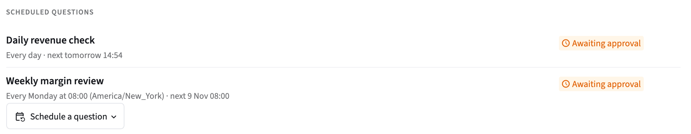<br><b>Recurring</b>: calendar schedules with their next run</td>
    <td width="50%">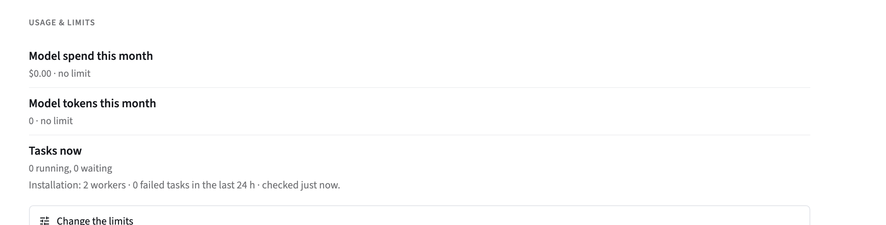<br><b>Usage & limits</b>: spend and work against the limits</td>
  </tr>
</table>

The [capability matrix](docs/CAPABILITY_MATRIX.md) lists each capability with its state and the test that proves
it, and [known gaps](docs/GAPS.md) lists what is missing.

## Models

Lyst calls models through OpenRouter on a gateway ported from Acumane's: workload routing, admission, adaptive
limits, retries with fallback, and the cost of every call. Each workspace picks a level, built daily from
OpenRouter's live catalog:

| Level | Models | Use it for |
|---|---|---|
| **Economy** | Each provider's fast line (Claude Haiku, GPT mini, Gemini Flash Lite, …) | High volume, simple questions |
| **Balanced** (default) | The mid lines (Claude Sonnet, Gemini Flash, Mistral Large, …) | Most work |
| **Frontier** | The flagships (Claude Opus, the newest GPT, Gemini Pro, Grok) | Hard investigations |

An administrator sets the default level and a ceiling; a workspace admin can also choose one specific model.
Settings › Models shows each level's models, OpenRouter's prices, the cost per call and per 1,000 calls, and
30-day spend. Quick steps such as classification run with thinking off, and an empty reply fails over to the
next model, so the computed answer always stands.

A local OpenAI-compatible server (Ollama, llama.cpp, vLLM) works instead: set `LYST_LLM_BASE_URL` and
`LYST_LLM_MODEL`. Details are in [docs/MODELS.md](docs/MODELS.md).

## Security and secrets

* **Credentials are never configuration.** The OpenRouter key, database passwords and API tokens are entered
  once in **Settings › Connections**, tested, sealed with AES-256-GCM envelope encryption, and never
  shown again. `.env` files refuse secret-shaped names. OpenBao is supported for enterprises.
* **The master key lives outside the data**: in the OS credential store (the Keychain on a Mac), a mounted
  secret file, or OpenBao, and never beside the database. `lyst init` sets it up and `lyst rotate-master-key`
  re-keys everything.
* **Encrypted at rest.** Every workspace is its own encrypted DuckDB file with a derived key.
* **Governed access.** Roles, workspace isolation, a read-only SQL guard with column and row policies,
  redaction before text reaches an external model (dataset rows are never sent), OIDC sign-in, and a
  hash-chained credential audit trail.

The threat model, autonomy levels and residual risks are in [docs/SECURITY.md](docs/SECURITY.md).

## Commands

| Command | What it does |
|---|---|
| `lyst start [--demo] [--no-browser]` | Everything in one terminal: encryption, the engine and the interface |
| `lyst init-demo` | Create the Northwind demo workspace and a development token |
| `lyst serve` | Run the API and workers (`http://127.0.0.1:8770`) |
| `lyst ui` | Run the Streamlit interface (`http://lyst.localhost:8501`, loopback only by default) |
| `lyst token EMAIL [--owner-of WS]` | Issue an API token, optionally creating a workspace with that user as owner |
| `lyst init [--recovery]` | Initialise encryption, or restore a saved master key |
| `lyst rotate-master-key` | Re-key every database and re-wrap every secret (engine stopped) |
| `lyst backup DEST` | Consistent, encrypted backup, also while the engine is running |
| `lyst restore SRC` | Verified restore into `LYST_HOME` (engine stopped) |
| `lyst prune` | Apply retention to events, calls, query history and notifications |
| `lyst eval` | Score the analytical question bank against independent answers |

Prefix each with `uv run` in a checkout. Ports move with `LYST_PORT` and `LYST_UI_PORT`, and data lives in
`LYST_HOME` (default `./var`). Other settings are environment variables documented at the top of
[`src/lyst/config.py`](src/lyst/config.py).

## Development

```bash
uv run pytest                        # the full suite; the PostgreSQL connector test uses a local server
uv run lyst eval --baseline docs/quality/eval-baseline.json   # 21 questions scored against independent answers and the baseline
uv run ruff check src tests scripts  # lint
uv run python scripts/licenses.py    # regenerate docs/SBOM.md and fail on a disallowed license
```

CI runs all four on every pull request and every push to main.

| Path | What |
|---|---|
| `src/lyst/` | The product: store, security, secrets, data, semantic, analyst, runtime, llm, api, ui, dashkit |
| `tests/` | Unit and acceptance tests, including the adversarial scenarios |
| `docs/` | Architecture, models, security, capability matrix, excellence registers, decisions |
| `scripts/` | License gate, load test and benchmarks |
| `site/` | The marketing website (a separate build; see its README) |

To run on a server, see [docs/DEPLOYMENT.md](docs/DEPLOYMENT.md) (Docker Compose, non-root, read-only).

## Documents

[Architecture](docs/ARCHITECTURE.md) · [Data platform](docs/PLATFORM.md) · [Capability matrix](docs/CAPABILITY_MATRIX.md) ·
[Models](docs/MODELS.md) · [Security](docs/SECURITY.md) · [Connectors](docs/CONNECTORS.md) ·
[Skills](docs/SKILLS.md) · [DuckDB design](docs/DUCKDB.md) · [Deployment](docs/DEPLOYMENT.md) ·
[Performance](docs/PERFORMANCE.md) · [Operations](docs/OPERATIONS.md) · [Anticipation](docs/ANTICIPATION.md) · [Adaptability](docs/ADAPTABILITY.md) · [Extensibility](docs/EXTENSIBILITY.md) · [UX strategy](docs/UX_STRATEGY.md) · [Product excellence](docs/PRODUCT_EXCELLENCE.md) ·
[Engineering excellence](docs/ENGINEERING_EXCELLENCE.md) · [Known gaps](docs/GAPS.md) ·
[Roadmap](docs/ROADMAP.md) · [Acumane audit](docs/ACUMANE_AUDIT.md) · [SBOM](docs/SBOM.md) ·
[Decisions](docs/decisions/)

## License

[GNU AGPL-3.0-only](LICENSE). If you run a modified Lyst as a network service, you must offer its users the
modified source (AGPL section 13). Every dependency is AGPL-compatible ([SBOM](docs/SBOM.md)). Vendored analytics
in `src/lyst/analytics/` come from the same author's ai-analytics project and are relicensed with Lyst.
